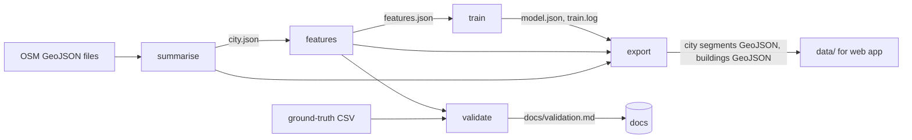

# Design Document: gloam-data-pipeline

## Overview

The gloam pipeline is an offline Python package, `gloam_pipeline`, under `pipeline/`. It turns OpenStreetMap (OSM) GeoJSON extracts into per-city files of walkable segments, each with an estimated lit probability, a confidence and a label source, plus a buildings file. The web app reads those files and never runs the pipeline.

Five stages, each a separate command: `summarise`, `features`, `train`, `validate`, `export`. Stages talk to each other only through files on disk.

Design principles, taken from the steering rules:

- **Pure core, thin I/O shell.** Loading, segment building, features, baselines, scoring, confidence, shift, metrics, report text and export content are pure functions of their arguments. Only `io.py` and `cli.py` touch the file system, the clock or stdout.
- **Validate inputs, name the argument.** Every public function rejects NaN, infinite and out-of-range values with `InvalidArgumentError(argument, value, allowed)`.
- **Untagged is unknown, not unlit.** This shapes training (R5), validation (R7) and the exported `label_source` (R6, R8).
- **Estimates stay estimates.** Every segment carries a `label_source` and a confidence. Wording in docs and report text uses "likely lit", "estimated" and "unknown". Nothing in this package claims a street is safe.
- **No user data.** Inputs are OSM extracts and an optional hand-labeled CSV of street ids. Nothing in any input or output identifies a person, device or location trail (R8.7).

### Research findings that shaped the design

- OSM `lit` tagging is positive-heavy: `lit=yes` is common, `lit=no` is rare, and most ways are untagged ([OSM wiki: Key:lit](https://wiki.openstreetmap.org/wiki/Key:lit)). This is why the model is trained as a positive-unlabeled (PU) problem and why AUC and precision use tagged segments only.
- scikit-learn's `LogisticRegression.fit` accepts `sample_weight`, and the `lbfgs` solver is deterministic for fixed data and order ([scikit-learn docs](https://scikit-learn.org/stable/modules/generated/sklearn.linear_model.LogisticRegression.html)). That gives weighted PU training and reproducibility (R5.4, R5.7) without custom optimisation code.
- Total variation distance between two histograms is bounded in 0 to 1, symmetric, and needs only stored bin proportions. That makes it a good fit for the shift measure (R6.10), because the training side can be saved as a small JSON object.

Content was rephrased for compliance with licensing restrictions.

### Open questions for the requirements owner

None remain. The extract format is confirmed: Overpass-style GeoJSON where each feature's top-level `id` looks like `way/123` and OSM tags are in `properties`. If the real extracts ever differ, only `classify.parse_osm_key` changes.

## Architecture



### Repository layout

```
pipeline/
├── data/                       # intermediate files, gitignored (never .kiro)
│   └── <city_id>/city.json, features.json
│   └── model.json, train.log
├── gloam_pipeline/
│   ├── errors.py               # error types (pure)
│   ├── checks.py               # argument validators (pure)
│   ├── config.py               # validated config dataclasses (pure)
│   ├── classify.py             # feature -> one of six types, OSM key parsing (pure)
│   ├── loader.py               # merge/dedupe/count parsed features, gather building footprints (pure)
│   ├── geometry.py             # projection, length, distance, point-in-polygon (pure)
│   ├── segments.py             # build segments, labels, reports (pure)
│   ├── features.py             # raw features, scaling, vectors (pure)
│   ├── shift.py                # distribution shift measure (pure)
│   ├── scoring.py              # probability, confidence, label source (pure)
│   ├── baselines.py            # rule and highway-rate baselines (pure)
│   ├── model.py                # PU weights, fit, predict, importance (fit uses scikit-learn)
│   ├── metrics.py              # AUC, precision, accuracy, road-type split (pure)
│   ├── validation.py           # hold-one-out orchestration, report data (pure)
│   ├── report.py               # render docs/validation.md text (pure)
│   ├── export.py               # build city and buildings GeoJSON dicts, parse back (pure)
│   ├── artifacts.py            # dict <-> dataclass for intermediate files (pure)
│   ├── io.py                   # read/write files, atomic writes, size check (I/O)
│   └── cli.py                  # argparse commands, summaries, exit codes (I/O)
└── tests/
```

No module imports from `io.py` or `cli.py` except `cli.py`. Dependencies point downward: `cli` → `io`, `validation`, `export`, ... → `scoring`, `features`, ... → `checks`, `errors`. No cycles.

### Dependencies

| Package | Use | Why needed |
|---|---|---|
| numpy | arrays for the model and metrics | required by scikit-learn; used for vectorised prediction |
| scikit-learn (new) | `LogisticRegression` fit with `sample_weight` | avoids hand-writing an optimiser; deterministic `lbfgs` solver. Used only inside `model.fit`. Version pinned exactly. |
| hypothesis (dev) | property-based tests | required by steering |
| pytest (dev) | test runner | standard |

Not added: shapely and geopandas (a local equirectangular projection plus a few small functions in `geometry.py` is enough at 2 km city scale), click (stdlib `argparse` is enough), pickle or joblib (the model is plain JSON, so it is readable and portable). Python 3.10 or later.

## Components and Interfaces

All signatures are indicative. All raise `InvalidArgumentError` for bad arguments.

### errors.py and checks.py

```python
class GloamError(Exception): ...
class InvalidArgumentError(GloamError):   # argument, value, allowed
class InputFileError(GloamError):         # path, problem
class DataError(GloamError):              # segment_id, field, value
class TrainingError(GloamError):          # message with counts / cities

def check_finite(name: str, value: float) -> float
def check_range(name: str, value: float, lo: float, hi: float,
                lo_open=False, hi_open=False) -> float
def check_text_length(name: str, value: str, lo: int, hi: int) -> str   # also rejects whitespace-only
def check_count_between(name: str, items: Sequence, lo: int, hi: int) -> Sequence
```

Every message has the form `argument 'feature_distance_m' rejected value nan; allowed 10 to 1000`.

### config.py

Frozen dataclasses validated in `__post_init__` (R3.2, R5.4, R6.6, R7.1, R8.3).

| Field | Default | Allowed |
|---|---|---|
| `feature_distance_m` | 100 | 10 to 1000 |
| `untagged_weight` | 0.2 | strictly between 0 and 1 |
| `high_value` | 0.9 | 0.5 to 1 inclusive |
| `low_value` | 0.1 | 0 to 0.5 inclusive; must be `< high_value` |
| `tagged_confidence` | 0.95 | 0.5 to 1 inclusive |
| `min_unlit_city` | 200 | integer >= 1 |
| `min_unlit_road_type` | 100 | integer >= 1 |
| `max_city_file_kb` | 5120 | > 0 |
| `max_buildings_file_kb` | 5120 | > 0 |
| `seed` | 0 | integer |
| `default_building_height_m` | 8.0 | finite, > 0 |

### classify.py and loader.py (R1)

```python
def parse_osm_key(feature: dict) -> tuple[str, int] | None     # ("way", 123)
def classify(feature: dict) -> str        # one of the six types or "other"
def merge_features(files: Sequence[Sequence[dict]]) -> MergeResult
def collect_building_footprints(features: Sequence[dict]) -> FootprintResult   # footprints + warning count
```

**Input format and key parsing.** Inputs are Overpass-style GeoJSON: each feature has a top-level `id` such as `way/123`, and OSM tags are in `properties`. `parse_osm_key` reads the top-level `id` first. It falls back to `properties["@id"]` only when the top-level `id` is missing or cannot be parsed. If neither parses, it returns `None` and the feature has no key (the synthetic key and warning in `merge_features` below apply). When both are present and differ, the top-level `id` wins.

Classification, first match wins, in this order:

1. `segment`: OSM way whose `highway` is in the R2.1 list.
2. `bus_stop`: `highway=bus_stop`.
3. `food`: `amenity` in {restaurant, cafe, fast_food, bar, pub, food_court}.
4. `shop`: any `shop` tag.
5. `building`: any `building` tag (summary classification only; see the footprint pass below).
6. `landuse`: any `landuse` tag on a polygon.
7. otherwise `other` (counted as unmatched, R1.6).

`merge_features` walks files in list order and features in file order, keeps the first occurrence of each `(element type, id)` and counts the rest as duplicates. A feature with no parseable id cannot be deduplicated; it is kept, given a synthetic unique key `("unknown", file_index, position)`, and counted as a warning. The result holds the deduplicated features, counts per type, unmatched count, duplicates removed and the warning count. Accounting identity: `input = unique + duplicates` and `unique = sum(six types) + unmatched`. The six-type summary is exclusive: each feature is counted once, under its first match.

**Building footprints are a separate pass.** `collect_building_footprints` scans all deduplicated features (not only those classified `building`) and keeps every Polygon that has a `building` tag, whatever its summary type. A polygon tagged both `shop` and `building` is therefore counted once in the summary (as `shop`, which matches before `building`) and also appears in the footprint list. The footprint list is not part of the exclusive counts and is not in the accounting identity; its length may be larger than the summary's `building` count. A feature with a `building` tag whose geometry is not a Polygon is left out of the list and counted as a warning. The footprint list feeds both the building-count feature (by centroid) and the buildings file.

`io.read_geojson(path)` is the only reader. It raises `InputFileError(path, problem)` for missing, unreadable, invalid or empty files, before any dataset is built (R1.3). `summarise` checks argument bounds (1 to 50 paths, name 1 to 100 characters and not whitespace-only) before reading any file (R1.4).

### geometry.py

- `Projector(lat0, lon0)`: local equirectangular projection to metres, with origin at the mean of the city's coordinates. At a 2 km radius the error is far below the 10 m minimum feature distance.
- `polyline_length_m(coords) -> float`: finite, >= 0.
- `point_polyline_distance_m(p, line) -> float`.
- `point_in_polygon(p, ring) -> bool`: ray casting, outer ring only.
- `GridIndex(items, cell_m)`: uniform grid with cell size equal to the feature distance, so a distance query touches at most 9 cells.

### segments.py (R2)

```python
@dataclass(frozen=True)
class Segment:
    osm_id: int; name: str; highway: str; footway: str
    coords: tuple[tuple[float, float], ...]   # (lon, lat), closing point kept for closed ways
    length_m: float; label: str               # tagged_lit | tagged_unlit | untagged

def build_segments(features: Sequence[dict]) -> SegmentResult   # segments + reports
def lit_label(value: str | None) -> tuple[str, bool]            # (label, recognised)
```

**Which geometry is accepted.** LineString, or Polygon (outer ring only). Anything else is unresolvable.

**Distinct nodes.** GeoJSON has no node ids, so "distinct nodes" means distinct coordinate pairs.

**Closed-way handling (R2.5, R2.6).**

| Case | Result |
|---|---|
| fewer than 2 distinct coordinates, or geometry missing or not LineString/Polygon | skipped, counted in `skipped_ways`, reason recorded |
| first coordinate equals last and at least 2 distinct coordinates (including every Polygon ring) | one segment, outline used as a line, closing point kept, length is the perimeter, counted in `closed_ways` |
| otherwise | ordinary open segment |

Skipping never stops processing of other ways.

**Label mapping (R2.7, R2.8).** `yes`, `24/7`, `automatic`, `dusk-dawn` → `tagged_lit`; `no` → `tagged_unlit`; missing → `untagged`; any other present value → `untagged` and added to `unrecognised_lit` as `{value: count}`. Matching is exact and case-sensitive, as OSM values are. Untagged segments are never dropped (R2.9).

### features.py (R3)

```python
@dataclass(frozen=True)
class RawFeatures:
    segment_id: int
    highway: str; footway_kind: str; length_m: float
    bus_stops: int; food_places: int; shops: int; buildings: int
    landuse: str; missing: bool

def raw_features(segments, points: PointSets, polygons: LanduseAreas,
                 feature_distance_m: float) -> list[RawFeatures]
def percentile_linear(sorted_values: Sequence[float], q: float) -> float   # q in 0..1, linear interpolation
def scale_counts(values: Sequence[int]) -> list[float]                     # min(1, c / p95), see below
def to_vector(raw: RawFeatures, scaled: ScaledCounts, length_scaled: float) -> list[float]
```

- Count features: number of bus stops, food places, shops and buildings whose location (point, or polygon centroid) is within `feature_distance_m` of the segment polyline. Bus stops, food places and shops come from the exclusive summary classification. Buildings come from the footprint list (every Polygon with a `building` tag, whatever its summary type), so a shop polygon that also carries a `building` tag counts as a shop and as a building.
- Land use: `landuse` of the first polygon (file order) that contains the segment midpoint, mapped to the fixed vocabulary {residential, commercial, retail, industrial, other}; `none` if no polygon contains it.
- Footway kind: {sidewalk, crossing, other, none}; any other non-empty `footway` value is `other`.
- The function takes only a city's own data (R3.5). It reads no `label` and no `lit` tag (R3.4, R10.3).

**Defaults and missing features (R3.7).** If a feature cannot be computed (for example the midpoint lookup fails on bad geometry), the segment gets `missing=True` and: counts 0, land use `none`, footway kind `none`, length 0.

**Scaling the four counts (R3.6).** Each count is scaled per city by that city's 95th percentile, capped at 1. Let `v` be the raw values of that count over the city's segments with `missing=False`.

- `p95` is the 95th percentile of `v` by linear interpolation (the numpy default): sort `v` ascending as `v[0..n-1]`, let `pos = 0.95 * (n - 1)`, `lo = floor(pos)`, `frac = pos - lo`, then `p95 = v[lo] + frac * (v[lo + 1] - v[lo])`, or `v[n - 1]` when `lo = n - 1`. It is a pure function `percentile_linear(sorted_values, q)`.
- If `v` has fewer than two distinct values (all equal, or empty) or `p95 = 0`: `scaled = 0.0` for every segment.
- Otherwise `scaled = min(1, c / p95)`.
- Segments with `missing=True` get `0.0`.

Why a percentile instead of min-max: one extreme segment (a mall with 80 shops nearby) would squash every other segment toward 0 under min-max. The 95th percentile keeps the ordinary range spread out, and the cap sends the top 5% to 1. 0.0 for a city with no spread is the cautious choice, because it gives the lowest density support in the confidence formula, so a city with no variation never looks better mapped than it is.

Hand-computed example: counts `[0, 2, 4]`, `n = 3`, `pos = 1.9`, `lo = 1`, `frac = 0.9`, `p95 = 2 + 0.9 * (4 - 2) = 3.8`. Scaled: `0 / 3.8 = 0.0`, `2 / 3.8 = 0.526` (0.5263 to 4 places), `min(1, 4 / 3.8) = min(1, 1.0526) = 1.0`. Result `[0.0, 0.526, 1.0]`. Counts `[3, 3]` → `[0.0, 0.0]` (constant). Twenty zeros and one 9: sorted, `n = 21`, `pos = 19`, `p95 = v[19] = 0`, so every scaled value is 0.0, including the 9.

**Monotonicity (R6.8).** Within one city `p95` is a single fixed number, and `c → min(1, c / p95)` is non-decreasing in `c`, so a higher raw count never gives a lower scaled count, and the confidence formula (non-decreasing in each scaled count) keeps R6.8 true. The constant and `p95 = 0` cases give the same value 0.0 for every count, which is also non-decreasing.

**Segment length** keeps min-max scaling (over segments with `missing=False`; `0.0` when fewer than two distinct lengths exist, and for missing segments). Length is not part of the confidence formula, so no monotonicity rule depends on it, and min-max is kept to avoid changing a feature the spec does not ask to change.

**Model vector (31 values).** highway one-hot (16, the R2.1 list) + footway kind one-hot (4) + scaled length (1) + four scaled counts (4) + land-use one-hot (6: residential, commercial, retail, industrial, other, none). Highway values outside the list cannot occur because such ways never become segments.

### shift.py (R6.10) — decision (a)

Measure: for each of the four raw counts, bin the values into {0, 1, 2, 3 to 5, 6 or more} and compute the bin proportions over segments with `missing=False`. Training side: the proportions pooled over all training cities, stored in `model.json`. For a city, `tvd_f = 0.5 * sum_over_bins |p_city - p_train|` (total variation distance, 0 to 1). The city's `shift = mean(tvd_f)` over the four features, in 0 to 1. Identical histograms give 0.

Penalty factor, with thresholds `T_LOW = 0.10` and `T_HIGH = 0.50`:

```
g(shift) = 1 - 0.5 * clamp((shift - T_LOW) / (T_HIGH - T_LOW), 0, 1)
```

So `g = 1` up to a shift of 0.10, falls linearly to 0.5 at a shift of 0.50, and stays at 0.5 beyond. `g` is non-increasing in `shift` and always in 0.5 to 1.

Thresholds are starting values chosen by judgement, not fitted. The measured shift of each exported city is written to the export metadata and the `features` summary so the thresholds can be reviewed against real cities. A city that is itself in the training set is compared with the pooled training histogram that includes it, so its shift is usually small.

Hand check: train proportions `[0.5, 0.2, 0.1, 0.1, 0.1]`, city `[0.7, 0.1, 0.1, 0.05, 0.05]`. Differences `[0.2, 0.1, 0, 0.05, 0.05]` sum to 0.4, so `tvd = 0.2`. If all four features give 0.2, `shift = 0.2` and `g = 1 - 0.5 * (0.1 / 0.4) = 0.875`.

### model.py (R5) — decisions (c) and (d)

**Model.** L2-regularised logistic regression (`C = 1.0`, `solver="lbfgs"`, `max_iter = 1000`). Description for `docs/model.md` (one paragraph, under 150 words): "The model is a logistic regression over 31 numeric features describing a street segment: its highway class, footway kind, length, nearby counts of bus stops, food places, shops and buildings, and land use. Counts are scaled within each city. Each feature gets a weight; the weighted sum is turned into a number between 0 and 1 that estimates how likely a street like this is to be tagged lit in OpenStreetMap. Weights are learned from streets that people have already tagged. Untagged streets count only a little as examples of 'not lit', because untagged means unknown."

**PU weighting (R5.1, R5.4, R5.6).** Every training segment is one row. Target and weight:

| label | target | weight |
|---|---|---|
| `tagged_lit` | 1 | 1 |
| `tagged_unlit` | 0 | 1 |
| `untagged` | 0 | `untagged_weight` (default 0.2) |

This is the weighted "unlabeled as down-weighted negatives" approach. It is simple and explainable, with a known cost: fitted probabilities are biased low, because untagged segments that are in fact lit still pull toward 0. The design does not apply a prior correction. Consequences, stated in `docs/validation.md`: the output is a relative likelihood that is useful for ranking, AUC is reported as the main figure, and precision at 0.5 can be "undefined" when nothing crosses the cutoff.

**Training steps.**

1. Check the list has 1 to 20 distinct cities and the held-out city (if any) is among the available cities and leaves at least one training city (R5.8, R5.9).
2. Drop the held-out city's rows.
3. Sort rows by `(city_id, segment_id)` so row order never depends on input order.
4. If there are zero `tagged_lit` rows, raise `TrainingError` naming the cities checked and the count (0), and write nothing (R5.2). If there are no rows with target 0 at all, raise `TrainingError` too, since a one-class fit is not possible.
5. Fit with `sample_weight`. Save to a temporary file and replace `model.json` only on success, so a failed run leaves any earlier model unchanged.
6. Write the training log (R5.3, R5.6, R5.10): the statement "untagged segments are unknown, not unlit; they are used as low-weight negatives", the three weights, the row counts per label, and the feature importance ranking.

**Feature importance (R5.10).** `|coefficient|` per feature. Features all live on 0 to 1 scales, so magnitudes are comparable. Ranked highest first; ties broken by feature name.

**Reproducibility (R5.7).** The `lbfgs` solver has no randomness; sorted rows make order irrelevant; scikit-learn is pinned exactly. The `seed` is still recorded in `model.json` and passed as `random_state`, so a later solver change cannot silently alter the contract. The saved model is only `intercept`, `coefficients` and `feature_names`; prediction is a pure numpy function (`sigmoid(x @ w + b)`) with no scikit-learn import, so predictions are the same wherever the JSON is read.

**Training artifact `model.json`** (plain JSON): `schema_version`, `feature_names`, `intercept`, `coefficients`, `training_cities`, `held_out_city`, `untagged_weight`, `seed`, `highway_rates` (for the baseline), `overall_lit_rate`, `unseen_highway_types`, `training_histograms` (for shift).

### scoring.py (R6) — decision (b)

```python
def score_segment(label: str, model_prob: float, features: ScaledCounts,
                  missing: bool, shift: float, cfg: ScoringConfig) -> Score
# Score(lit_probability, confidence, label_source)
```

`model_prob` is the raw model output in 0 to 1. For tagged segments it is ignored.

| label | label_source | lit_probability | confidence |
|---|---|---|---|
| `tagged_lit` | `tagged_lit` | `high_value` | `tagged_confidence` |
| `tagged_unlit` | `tagged_unlit` | `low_value` | `tagged_confidence` |
| `untagged` | `estimated` | `model_prob` | formula below |

Tagged tags are never overwritten by the model (R6.2). For tagged segments confidence does not read any count (R6.4).

**Confidence for estimated segments.**

```
support    = (s_bus + s_food + s_shop + s_building) / 4            # 0..1
base       = tagged_confidence * (0.25 + 0.60 * support)           # 0.25*tc .. 0.85*tc
conf       = base * (0.7 if missing else 1.0) * g(shift)
```

Why this meets each rule:

- **Strictly below tagged confidence (R6.7):** the largest possible value is `tc * 0.85 * 1 * 1 < tc` because `tc >= 0.5 > 0`.
- **Non-decreasing in bus stop, food and shop counts (R6.8):** `conf` is non-decreasing in each scaled count, and the per-city scaling is non-decreasing in the raw count. The pure function takes scaled values, so the property is checked directly on it.
- **Strictly lower with missing features (R6.9):** the multiplier is 0.7 and `base > 0`.
- **Reduced by shift (R6.10):** `g` is non-increasing in `shift`.
- **Always finite and in 0 to 1:** each factor is in range and `tc <= 1`.

Hand-checked example, `tc = 0.95`, scaled counts `(0.8, 0.4, 0.2, 0.6)`: support 0.5, `base = 0.95 * 0.55 = 0.5225`. With no missing features and shift 0.2 (`g = 0.875`): 0.4571875, exported as 0.457. With missing features: `0.5225 * 0.7 * 0.875 = 0.32003125`, exported as 0.320. Lowest possible with `tc = 0.95`: `0.95 * 0.25 * 0.7 * 0.5 = 0.083125`.

**Guard (R6.12).** Every score passes `assert_valid_score(segment_id, field, value)`; a NaN, infinite or out-of-range value raises `DataError` naming the segment and field, and the export is not written.

Scoring is a pure function of its arguments, so repeated runs match (R6.11).

### baselines.py (R4) — decision (i)

```python
RULE_LIT_CLASSES = frozenset({"primary", "secondary", "tertiary"})
def rule_baseline(highway: str) -> float          # 1.0 or 0.0
def learn_highway_rates(training: Sequence[(highway, label)]) -> HighwayRates
def highway_rate_baseline(rates: HighwayRates, highway: str) -> float
```

- Rule baseline: depends on highway class only (R4.2).
- Highway-rate baseline: for each type, `rate = lit / (lit + unlit)` over training cities' tagged segments. A type with no tagged segments uses `overall_lit_rate = lit / (lit + unlit)` over all training cities, and the count of such types is recorded (`unseen_highway_types`, R4.5). Held-out city segments are never passed to `learn_highway_rates` (R4.3). If the training set has no tagged segments at all, the function raises `TrainingError`.
- Example: residential has 30 `tagged_lit` and 10 `tagged_unlit` → 0.75; training totals of 70 lit and 30 unlit give an overall rate of 0.7.

### metrics.py and validation.py (R7) — decision (i)

```python
def auc(scores, is_positive) -> float | None          # None = undefined
def precision_at(scores, is_positive, cutoff=0.5) -> float | None   # None = undefined
def road_type(highway: str) -> str                    # "walking_path" | "vehicle_road"
def city_metrics(rows, cfg) -> CityMetrics
def ground_truth_accuracy(rows) -> GTResult
```

**AUC.** Mann-Whitney form with average ranks for ties: `(sum of positive ranks - P(P+1)/2) / (P * N)`. Hand example: positive scores `[0.9, 0.6]`, negative `[0.6, 0.2]`. Pairs: 0.9>0.6 (1), 0.9>0.2 (1), 0.6=0.6 (0.5), 0.6>0.2 (1). AUC = 3.5 / 4 = 0.875. Undefined (`None`) when there are no positives or no negatives. Written in `metrics.py` instead of calling scikit-learn, so it is easy to property-test and does not depend on the training library.

**Precision.** `TP / (TP + FP)` where predicted lit means score `>= 0.5`. When nothing is predicted lit, the result is `None` and the report prints "undefined", never 0 (R7.11).

**Rows and labels.** Positives are `tagged_lit`; negatives are `tagged_unlit`; `untagged` rows are dropped before either metric (R7.2).

**Which scores.** Validation uses the raw model output for every segment, including tagged ones, since the tags are hidden from the model (features never use `lit`). It does not use `score_segment`, which would copy the tags back in.

**Hold-one-out procedure (R7.1, R7.8).**

1. Cities with at least `min_unlit_city` (default 200) `tagged_unlit` segments qualify; others are listed as skipped with count and threshold.
2. For each qualifying city, train on all other available cities (never the city itself), learn highway rates from the same set, then score the city's segments with the model, the rule baseline and the highway-rate baseline on identical segment sets (R4.6). If the sets differ, raise an error naming the city and split, and write no baseline metrics (R4.8).
3. Split rows into walking paths (pedestrian, footway, path, cycleway, steps) and vehicle roads (everything else listed in R2.1).
4. For each road type, compute AUC and precision only when the city has at least `min_unlit_road_type` (default 100) `tagged_unlit` segments of that type; otherwise list it as skipped with count and threshold (R7.4, R7.5). There is no combined figure (R7.3).
5. If the model AUC is not higher than a baseline's AUC for the same city and road type, the report states "the model did not beat <baseline>" with both figures, separately for each baseline (R7.9). If either AUC is undefined, no comparison is made and the report says so.

**Ground-truth city guard.** Ground truth is scored with the saved `model.json`. If that model was trained on the ground-truth city, the accuracy would be measured on streets the model has already seen. So when `--ground-truth` is given, `validate` first calls the pure function `check_ground_truth_city(gt_city, held_out_city)`. It raises `InvalidArgumentError` naming both values (for example `argument '--ground-truth-city' value 'kl_core' does not match model.json held_out_city None; train with --held-out kl_core`) when `held_out_city` is null or differs from `gt_city`. This is a hard error, not the status-3 "not run" case: it exits with status 2, and `validate` stops before doing any work and writes nothing, leaving any existing `docs/validation.md` unchanged. Status 3 is kept for ground-truth file problems only.

**Ground truth (R7.6, R7.10).** CSV columns `osm_id,label` where `label` is `lit`, `dark` or `unsure`. Rows marked `unsure` are excluded and their count is reported. Accuracy is the share of rows where `(score >= 0.5) == (label == "lit")`, for the model, the rule baseline and the highway-rate baseline, using the saved `model.json`. If the file is missing, unreadable, or has only `unsure` rows, the report section is "not run" with the reason. Rows whose `osm_id` is not a segment of the city are counted and reported.

**Report (`report.py`, R7.7, R4.7).** `render_validation(data) -> str` is pure. It contains: per-city counts of `tagged_lit`, `tagged_unlit`, `untagged`; metric tables with model, rule baseline and highway-rate baseline side by side, three decimal places, "undefined" where needed; skipped cities and road types; the statement that AUC and precision use tagged segments only; the caveat that untagged segments are unknown rather than unlit; the low-bias note on probabilities. The writer saves it to `docs/validation.md`.

### export.py (R8) — decision (h)

```python
def build_city_collection(city, segments, scores, shift, cfg) -> dict
def build_buildings_collection(city, buildings, cfg) -> dict
def parse_city_collection(doc: dict) -> list[ExportedSegment]       # reload, used by tests
def building_height_m(tags: dict, default: float) -> float
```

**City segments file** (`<out_dir>/<city_id>.segments.geojson`), a GeoJSON FeatureCollection with a foreign member `metadata`:

```json
{
  "type": "FeatureCollection",
  "metadata": {
    "schema_version": 1,
    "kind": "segments",
    "city": "Kuala Lumpur",
    "attribution": "© OpenStreetMap contributors",
    "licence": "ODbL 1.0 (https://www.openstreetmap.org/copyright)",
    "estimates_note": "Lit probabilities marked 'estimated' are model estimates, not records.",
    "distribution_shift": 0.217,
    "segment_count": 1234
  },
  "features": [{
    "type": "Feature",
    "geometry": {"type": "LineString", "coordinates": [[101.686855, 3.139003], [101.687100, 3.139500]]},
    "properties": {"id": 123456, "name": "Jalan Example", "highway": "residential",
                   "lit_probability": 0.412, "confidence": 0.320, "label_source": "estimated"}
  }]
}
```

The property list is an allow-list: `id`, `name`, `highway`, `lit_probability`, `confidence`, `label_source`. Nothing else is copied from inputs, so no user, device or location-trail data can reach an output (R8.7). Names are plain OSM names, empty string when missing. Coordinates are rounded to 6 decimals and probabilities and confidence to 3 (R8.2). JSON is written compact (no extra whitespace) to keep files small.

**Buildings file** (`<out_dir>/<city_id>.buildings.geojson`): same `metadata` block with `"kind": "buildings"` and `"default_building_height_m"`. Each feature is a Polygon (outer ring, 6 decimals) with `properties: {"height_m": <number>}`. Height: parse the `height` tag after stripping an optional trailing `m`; use it if it is finite and `> 0`, otherwise the configured default (8.0 m, documented in `docs/`). The buildings come from the footprint list (every Polygon with a `building` tag, whatever its summary type), so a polygon tagged both `shop` and `building` appears here. Building-tagged features whose geometry is not a Polygon were already left out by the footprint pass and counted as a warning.

**Size handling (R8.3, extended to the buildings file).** The original R8.3 covered only the city segments file. This design extends it to the buildings file, and requirements R8.3 carries the same change (default 5 MB for each file, configured separately by `max_city_file_kb` and `max_buildings_file_kb`). Both files go through the same check. `io.write_geojson_checked(path, doc, limit_kb)` writes to a temporary file in the same folder, measures its size, and:

- if size is within the limit, atomically renames it onto the final path and returns the size in kilobytes (reported in the summary, R8.2);
- if over the limit, deletes the temporary file and raises an error naming the city, the file (segments or buildings), the actual size and the limit. No oversized file is left, and any earlier valid file is untouched.

**Validity (R8.6).** Before serialising, every value is checked; a bad value raises `DataError(segment_id, field, value)` and nothing is written.

### artifacts.py and io.py

`artifacts.py` converts dataclasses to and from plain dicts for `city.json`, `features.json` and `model.json` (pure; round-trip tested). `io.py` reads and writes them. All writes go to a temporary file and are renamed on success, so a failing command never leaves a partial file (R9.5, R9.6).

- `city.json`: city identifier, name, segments (without raw tags other than the label), the point sets (bus stops, food places, shops, building centroids), building footprints and height tags (from the footprint pass, so including building-tagged shop and food polygons), land-use polygons, and the reports (counts by type, unmatched, duplicates, skipped and closed ways, unrecognised `lit` values).
- `features.json`: raw features per segment, scaled counts, the feature distance used, and the city's measured shift once a model exists (the shift is computed at export time).
- `model.json`: described above.

### cli.py (R9) — decision (g)

Invocation: `python -m gloam_pipeline <command> [options]`, built with `argparse` sub-commands. City identifiers match `[a-z0-9_]{1,50}` and name a folder under `pipeline/data/`.

| Command | Purpose | Required arguments | Optional | Reads | Writes |
|---|---|---|---|---|---|
| `summarise` | load, dedupe, build segments, print counts | `--city-id`, `--city-name`, `--input FILE [FILE ...]` | `--data-dir` | GeoJSON files | `<city>/city.json` |
| `features` | build features | `--city-id` | `--feature-distance-m` (100), `--data-dir` | `city.json` | `<city>/features.json` |
| `train` | fit model | `--cities ID [ID ...]` | `--held-out`, `--untagged-weight` (0.2), `--seed` (0), `--data-dir` | `features.json` of each city | `model.json`, `train.log` |
| `validate` | hold-one-out metrics and ground truth | `--cities ID [ID ...]` | `--ground-truth FILE`, `--ground-truth-city ID`, `--min-unlit-city`, `--min-unlit-road-type`, `--untagged-weight`, `--docs-dir` | `features.json`, `model.json` | `docs/validation.md` |
| `export` | score and export | `--city-id` | `--out-dir` (repo `data/`), `--high-value`, `--low-value`, `--tagged-confidence`, `--max-city-file-kb`, `--max-buildings-file-kb`, `--data-dir` | `city.json`, `features.json`, `model.json` | `<city>.segments.geojson`, `<city>.buildings.geojson` |

Each command runs only its own stage from files already on disk (R9.2). `-h/--help` prints name, purpose and arguments and exits 0 (R9.7).

**Summary and warnings (R9.3, R9.4).** Warnings are collected by the pure code as a list of strings and printed one per line as `warning: ...` before the final summary: command name, city identifier, records processed, files written, warning count.

**Exit status.**

| Status | Meaning |
|---|---|
| 0 | success |
| 1 | data error (bad file contents, `TrainingError`, `DataError`, oversized output) |
| 2 | missing or invalid argument, or missing input file (argparse also uses 2); also a ground-truth city that does not equal `model.json` `held_out_city` |
| 3 | validation finished and `docs/validation.md` was written, but the ground-truth section is "not run" (R7.10). This is the one exception to "write nothing" in R9.5, which requirements R9.5 now states |

Errors print one line naming the argument or file and, for argument errors, the rejected value (R9.5, R9.6), and leave existing output files unchanged.

## Data Models

```python
@dataclass(frozen=True)
class Segment: osm_id:int; name:str; highway:str; footway:str; coords:tuple; length_m:float; label:str

@dataclass(frozen=True)
class BuildingFootprint: osm_id:int; ring:tuple; height_tag:str      # any Polygon with a building tag

@dataclass(frozen=True)
class RawFeatures: segment_id:int; highway:str; footway_kind:str; length_m:float
                   bus_stops:int; food_places:int; shops:int; buildings:int; landuse:str; missing:bool

@dataclass(frozen=True)
class ScaledCounts: bus:float; food:float; shop:float; building:float; length:float   # all 0..1

@dataclass(frozen=True)
class Score: lit_probability:float; confidence:float; label_source:str

@dataclass(frozen=True)
class SegmentReports: skipped_ways:list; closed_ways:int; unrecognised_lit:dict[str,int]

@dataclass(frozen=True)
class Model: feature_names:list[str]; intercept:float; coefficients:list[float]
             training_cities:list[str]; held_out_city:str|None; untagged_weight:float; seed:int
             highway_rates:dict[str,float]; overall_lit_rate:float; unseen_highway_types:int
             training_histograms:dict[str, list[float]]

@dataclass(frozen=True)
class CityMetrics: city:str; road_type:str; counts:dict[str,int]; skipped:str|None
                   auc:dict[str,float|None]; precision:dict[str,float|None]    # keys: model, rule, highway_rate
```

Allowed values: `label` in {tagged_lit, tagged_unlit, untagged}; `label_source` in {tagged_lit, tagged_unlit, estimated}; `road_type` in {walking_path, vehicle_road}. Walkable highway set (R2.1): primary, secondary, tertiary, unclassified, residential, living_street, service, pedestrian, footway, path, cycleway, track, steps, primary_link, secondary_link, tertiary_link.

## Correctness Properties

*A property is a characteristic or behavior that should hold true across all valid executions of a system-essentially, a formal statement about what the system should do. Properties serve as the bridge between human-readable specifications and machine-verifiable correctness guarantees.*

Reflection applied (Properties 28, 29 and 30 cover the building-footprint pass, the ground-truth city guard and the OSM key id order): R2.1, 2.2, 2.7, 2.8 and 2.9 merge into one segment-building property; R6.2 to 6.5 and 6.7 merge into one label-source property; AUC and "undefined precision" merge into one metrics property; argument-validation cases (R1.4, 3.3, 5.5, 6.6, 8.6, 10.8) merge into two properties (inputs, and outputs).

### Property 1: Merge keeps the first copy and accounts for every feature

*For any* list of feature lists (1 to 50 files) containing repeated `(element type, id)` keys, the merged dataset contains exactly one feature per distinct key, each being the first occurrence in file-list order; the counts of the six types plus unmatched equal the number of unique features; and unique plus duplicates removed equals the number of input features.

**Validates: Requirements 1.2, 1.5, 1.6**

### Property 2: Invalid arguments are rejected and named

*For any* input argument outside its documented range (empty, over-long or whitespace-only city name; empty or over-50 path list; feature distance, untagged weight, high value, low value, tagged confidence or size limit that is NaN, infinite or out of range; high value not greater than low value; scoring inputs that are NaN, infinite or out of range), the call raises `InvalidArgumentError` whose message names the argument, and produces no result.

**Validates: Requirements 1.4, 3.3, 5.5, 6.6, 10.8**

### Property 3: Segment building selects exactly the walkable ways and labels all of them

*For any* list of ways with arbitrary `highway` and `lit` values, the segment ids equal the ids of ways whose highway is in the R2.1 list and whose geometry resolves; no segment exists for any other way; each segment's label follows the `lit` mapping; every present-but-unrecognised `lit` value is counted in `unrecognised_lit` and labelled `untagged`; and the counts of `tagged_lit`, `tagged_unlit` and `untagged` sum to the number of segments.

**Validates: Requirements 2.1, 2.2, 2.7, 2.8, 2.9**

### Property 4: Lengths are valid and degenerate or closed ways are handled

*For any* walkable way, a built segment has a finite length `>= 0`; a way with fewer than 2 distinct coordinates is skipped, counted, and does not stop the other ways from being built; a closed way with at least 2 distinct coordinates becomes one segment and is counted as closed.

**Validates: Requirements 2.4, 2.5, 2.6**

### Property 5: Percentile-capped scaling stays in range and is monotone

*For any* list of non-negative integer counts, every scaled value equals `min(1, c / p95)` and lies between 0 and 1 inclusive; scaling is non-decreasing in the raw count; and a list with fewer than two distinct values, or with `p95 = 0`, scales to all 0.0. Also, *for any* sorted list of finite numbers, `percentile_linear` at q = 0.95 lies between the minimum and maximum of the list.

**Validates: Requirements 3.6**

### Property 6: Features do not depend on input order or other cities

*For any* city's segments and point sets, every permutation of the segment list yields identical features for each segment id, and the features of a city are unchanged by the presence or content of any other city's data.

**Validates: Requirements 3.5, 10.2**

### Property 7: Features ignore the lit tag

*For any* segment, changing or removing its `lit` value (and so its label) produces identical raw features, scaled counts and feature vector for that segment.

**Validates: Requirements 3.4, 10.3**

### Property 8: Training weights follow the label

*For any* list of labelled training rows and any valid untagged weight, `tagged_lit` rows get target 1 and weight 1, `tagged_unlit` rows get target 0 and weight 1, and `untagged` rows get target 0 and weight equal to the untagged weight, which is strictly between 0 and 1.

**Validates: Requirements 5.1, 5.4, 5.6**

### Property 9: Training is reproducible

*For any* small generated training set containing at least one `tagged_lit` segment and at least one target-0 row, two training runs with the same data, configuration and seed produce lit probabilities for every segment that agree to at least 6 decimal places, regardless of the input order of the rows.

**Validates: Requirements 5.7**

### Property 10: The held-out city does not influence the model

*For any* set of training cities and a held-out city, replacing the held-out city's segments with any other segments leaves the trained coefficients unchanged, and no held-out segment is used to learn highway rates.

**Validates: Requirements 4.3, 5.8**

### Property 11: Feature importance covers every feature in ranked order

*For any* trained model, the importance list has exactly one value per input feature and is sorted from highest to lowest.

**Validates: Requirements 5.10**

### Property 12: Scores are finite and in range

*For any* label, model probability in 0 to 1, scaled counts in 0 to 1, missing flag, shift in 0 to 1 and valid configuration, the lit probability and the confidence are each finite and between 0 and 1 inclusive.

**Validates: Requirements 6.1, 10.1**

### Property 13: Label source, tagged values and estimated confidence are consistent

*For any* segment and valid configuration: a `tagged_lit` segment has label source `tagged_lit`, probability `>= high_value` and confidence equal to `tagged_confidence`; a `tagged_unlit` segment has label source `tagged_unlit`, probability `<= low_value` and confidence equal to `tagged_confidence`, for any counts; an `untagged` segment has label source `estimated`, probability equal to the model probability, and confidence strictly below `tagged_confidence`.

**Validates: Requirements 6.2, 6.3, 6.4, 6.5, 6.7, 10.4**

### Property 14: More nearby places never lower confidence

*For any* two estimated segments identical except for a higher scaled bus-stop, food-place or shop count in one, the confidence of the segment with the higher count is greater than or equal to the other.

**Validates: Requirements 6.8, 10.6**

### Property 15: Missing features lower confidence

*For any* estimated segment, the same segment flagged as having missing features has strictly lower confidence.

**Validates: Requirements 6.9**

### Property 16: Distribution shift never raises confidence

*For any* histogram pair the shift is between 0 and 1, and is 0 for identical histograms; and *for any* estimated segment and any two shifts `a <= b`, the confidence under `b` is less than or equal to the confidence under `a`.

**Validates: Requirements 6.10, 10.7**

### Property 17: Scoring is deterministic

*For any* segment inputs and configuration, scoring the same inputs repeatedly returns identical lit probability, confidence and label source.

**Validates: Requirements 6.11**

### Property 18: Rule baseline depends on highway class only

*For any* two segments with the same highway class and any other differences (label, features, city), the rule baseline gives the same output; the output is lit exactly when the class is in the rule set.

**Validates: Requirements 4.1, 4.2**

### Property 19: Highway-rate baseline uses the training rate, with fallback

*For any* training set of tagged segments, a highway type with at least one tagged segment is predicted at `lit / (lit + unlit)` for that type; a type with none is predicted at the overall lit rate; the prediction does not change when any non-highway attribute of the predicted segment changes.

**Validates: Requirements 4.3, 4.4, 4.5**

### Property 20: AUC and precision are valid or explicitly undefined

*For any* scores and tagged classes, AUC is between 0 and 1 or undefined (no positives or no negatives); negating all scores maps a defined AUC `a` to `1 - a`; precision is between 0 and 1 when at least one segment scores `>= 0.5`, and is undefined, not 0, when none does.

**Validates: Requirements 7.1, 7.11**

### Property 21: Metrics use tagged segments only and respect road-type minimums

*For any* set of segments, adding any number of `untagged` segments leaves AUC and precision unchanged; every segment belongs to exactly one road type; and a road type's metrics are computed if and only if the city has at least the configured number of `tagged_unlit` segments of that type (and a city is validated if and only if it has at least the city minimum), otherwise it is listed as skipped with its count.

**Validates: Requirements 7.2, 7.3, 7.4, 7.5, 7.8**

### Property 22: Ground-truth accuracy excludes unsure rows

*For any* ground-truth rows, the reported accuracy is computed over the rows not marked `unsure`, the reported excluded count equals the number of `unsure` rows, and accuracy is between 0 and 1.

**Validates: Requirements 7.6**

### Property 23: The did-not-beat statement appears exactly when it should

*For any* model AUC and baseline AUC that are both defined, the report text contains a "did not beat" statement for that baseline, with both figures, if and only if the model AUC is not higher than the baseline AUC.

**Validates: Requirements 7.9**

### Property 24: Export and reload preserve segments within rounding

*For any* generated city of 0 to 1,000 scored segments, exporting and then parsing the result gives exactly the same set of segment ids, the same label sources, probabilities and confidence differing from the original by no more than 0.001, and coordinates equal to the original rounded to 6 decimals.

**Validates: Requirements 8.1, 8.2, 10.5**

### Property 25: Export rejects invalid values

*For any* segment whose probability or confidence is NaN, infinite or outside 0 to 1, building the export raises `DataError` naming the segment id and field, and produces no document.

**Validates: Requirements 6.12, 8.6**

### Property 26: Building height uses a valid tag or the default

*For any* height tag string, the building height equals the parsed value (after an optional trailing `m`) when it is finite and positive, and otherwise equals the configured default; the result is always finite and positive.

**Validates: Requirements 8.4**

### Property 27: Intermediate files round-trip

*For any* valid city dataset, feature set and model, converting to the JSON form and back gives an equal object.

**Validates: Requirements 9.2** (stages communicate through files, so the files must preserve the data)

### Property 28: Any building-tagged polygon is a footprint, and the summary counts it once

*For any* list of deduplicated features, the footprint list contains exactly the features that are Polygons with a `building` tag, whatever their summary type (including a polygon tagged both `shop` or food and `building`); each such feature is still counted exactly once in the six-type summary, so the summary counts plus unmatched still equal the number of unique features; and each building-tagged feature that is not a Polygon is absent from the footprint list and adds one to the warning count.

**Validates: Requirements 1.5, 1.6, 3.1, 8.4**

### Property 29: Ground truth is only scored with a model that held out its city

*For any* ground-truth city id and any `held_out_city` value (including null), `check_ground_truth_city` passes if and only if `held_out_city` is not null and equals the ground-truth city id; otherwise it raises `InvalidArgumentError` whose message contains both values.

**Validates: Requirements 7.6** (design decision: a model trained on the ground-truth city would inflate accuracy)

### Property 30: Top-level id wins, with fallback to `@id`

*For any* element type, any two ids `a` and `b` (including `a = b`), and any feature built from them: a feature with top-level `id` `"<type>/<a>"` and `properties["@id"]` `"<type>/<b>"` parses to `(type, a)`; a feature with an absent or unparseable top-level `id` and a parseable `properties["@id"]` of `"<type>/<b>"` parses to `(type, b)`; a feature with neither parseable returns no key.

**Validates: Requirements 1.2** (design decision: confirmed extract format and id order)

## Error Handling

| Condition | Error | Effect |
|---|---|---|
| Missing, unreadable, invalid or empty input file | `InputFileError(path, problem)` | stop before building the dataset (R1.3) |
| Bad argument or config value | `InvalidArgumentError(argument, value, allowed)` | stop before reading files or computing (R1.4, R3.3, R5.5, R6.6) |
| Way with fewer than 2 distinct points or unresolvable geometry | warning + `skipped_ways` entry | continue (R2.5) |
| Feature cannot be computed for a segment | defaults + `missing=True` | continue (R3.7) |
| No `tagged_lit` rows, or no target-0 rows | `TrainingError` with cities and counts | no model written, old model kept (R5.2) |
| Held-out city unknown or leaves no training city | `InvalidArgumentError` naming the city | no training (R5.9) |
| Baseline and model segment sets differ | error naming city and split | no baseline metrics (R4.8) |
| NaN, infinite or out-of-range score or export value | `DataError(segment_id, field, value)` | no output for that city (R6.12, R8.6) |
| City file or buildings file over its size limit | error with city, file, size, limit | temp file deleted, no oversized file left, earlier valid file untouched (R8.3) |
| Building-tagged feature that is not a Polygon | warning | left out of the footprint list, processing continues |
| Ground-truth city differs from `model.json` `held_out_city`, or `held_out_city` is null | `InvalidArgumentError` naming both values | hard error, exit status 2, nothing written; prevents scoring ground truth with a model trained on that city |
| Ground truth missing, unreadable or only `unsure` | reported reason, section "not run" | rest of report written, exit status 3 (R7.10) |
| Model or highway-rate baseline predicts no lit segments | precision "undefined" | not an error (R7.11) |

All writes are temp-file-then-rename, so any failing command leaves existing outputs unchanged (R9.5, R9.6).

## Testing Strategy

Property-based testing applies: the core is pure functions over large input spaces (parsing, scoring, metrics, serialisation). I/O, the CLI and the one external library call (the scikit-learn fit) are covered by example tests.

**Library and configuration.** Hypothesis for Python. Each correctness property is one Hypothesis test with `max_examples >= 100` (set in a shared settings profile). Each test carries a comment tag in the form `# Feature: gloam-data-pipeline, Property N: <property text>`. Hypothesis reports the shrunk minimal failing example (R10.9). Training properties (9 and 10) use small generated datasets (tens of rows) so 100 examples run quickly.

**Generators** (in `pipeline/tests/strategies.py`): OSM-like features (ways, points, polygons) with random tags including unrecognised `lit` strings; coordinates inside a small box; counts; histograms; label lists; configs inside valid ranges; invalid values from `st.one_of(nan, inf, -inf, out-of-range)`.

**Unit and example tests** (`pipeline/tests/`):

- Loader: three files with one missing, one invalid, one empty (R1.3); merge of two small files (R1.1).
- Key parsing (`parse_osm_key`): top-level `id` `"way/123"` with `properties["@id"]` `"way/456"` gives `("way", 123)`; top-level `id` absent with `"@id"` `"way/456"` gives `("way", 456)`; unparseable top-level `id` (for example `"abc"`) with a valid `"@id"` falls back to the `"@id"`; neither present gives `None`, and `merge_features` then assigns the synthetic key and adds one warning. Property 30 covers the same rules over generated ids.
- Features: one hand-built street with known bus stops, food places, shops and buildings at known distances; land-use midpoint lookup; missing-feature defaults (R3.1, R3.7); the hand-computed scaling example (`[0, 2, 4]` → `[0.0, 0.526, 1.0]` with `p95 = 3.8`; `[3, 3]` → zeros; twenty zeros and one 9 → all zeros); a polygon tagged both `shop` and `building` is counted once as a shop in the summary and also counted as a building feature and written to the buildings file.
- Training: zero `tagged_lit` rows leaves an existing `model.json` unchanged (R5.2); the training log contains the unknown-not-unlit statement and the three weights (R5.3, R5.6); unknown held-out city (R5.9); word count of `docs/model.md` is under 150 (R5.11).
- Scoring: the hand-computed confidence values 0.457, 0.320 and 0.083125 from the formula above; NaN injected into a computed score raises `DataError` (R6.12).
- Metrics: the hand-computed AUC of 0.875 and the 0.75 and 0.7 highway rates.
- Validation: baseline and model on identical segment sets; mismatch error (R4.6 to R4.8); report contents including per-class counts, tagged-only statement and the unknown-not-unlit caveat (R7.7); ground-truth file missing, unreadable, only `unsure` (R7.10, exit status 3, report still written); ground-truth city different from `held_out_city`, or `held_out_city` null, exits 2 with both values in the message and writes nothing (an existing `docs/validation.md` is unchanged).
- Export: attribution text and licence name present in both files (R8.5); only allow-listed properties present (R8.7); an oversized city file and an oversized buildings file are each removed, the error names city, file, size and limit, and an earlier valid file is untouched (R8.3), using a temporary directory.
- CLI: five commands run end to end on a tiny fixture city; summary and `warning:` lines; missing argument or file exits 2 and writes nothing; invalid value names the argument; `--help` exits 0 (R9.1 to R9.7).

**Wording check.** A small test scans package strings, report templates and docs for the banned words listed in the product rules and fails if any appear.

**Example values.** Every number written in tests or docs above was computed by hand against the formulas before use, as the technical rules require.

**Not property-tested:** file I/O, argparse wiring, and scikit-learn's solver itself. These use example or integration tests.
