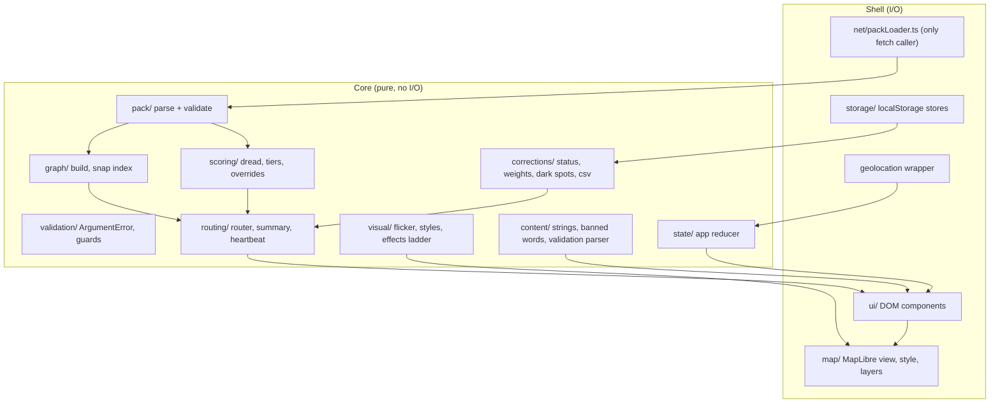

# Design Document

## Overview

The Gloam web app (`app/`) is a static browser app. It loads one small City_Pack at a time, draws a dark 2.5D map with MapLibre GL JS, and plans walking routes on the device by trading distance against Dread. There is no server of our own: no routing server, no database, no accounts.

The design follows the steering rules:

- TypeScript with Vite, no UI framework. `maplibre-gl` is the only runtime dependency. Vitest and `fast-check` are dev dependencies.
- Scoring, tiers, graph building, routing, status rules, CSV, flicker maths and wording checks are pure modules with no I/O and no hidden state. All I/O (fetch, local storage, geolocation, the map, the DOM) sits in a thin shell around them.
- Every pure function that takes numbers validates them and throws an `ArgumentError` whose message contains the argument name.
- No fixed probability cut-off exists anywhere. Estimated lighting is described by Rank within the loaded City_Pack only.
- Banned words, the Disclaimer, the "SAMPLE DATA" label and the privacy limits are enforced by structure (one string catalogue, one network module) and by tests.

Static hosting is confirmed as a Render static site. Everything that depends on it is isolated behind a build-time flag (`VITE_GLOAM_HOSTED`) and a standard Vite `dist/` output.

### Research summary

- OpenFreeMap documents that custom styles are allowed, and that a customised style must be hosted by the app itself. That matches the requirement that the map style is bundled ([OpenFreeMap quick start](https://openfreemap.org/quick_start/)). The bundled style references the OpenFreeMap vector source and glyphs. The exact source and glyph URLs are copied from OpenFreeMap's published `liberty` style at implementation time and recorded in `style.ts`; they are not guessed here.
- The `data/*.segments.geojson` files in the repository show the real input shape: `metadata` holds `schema_version`, `kind`, `city`, `attribution`, `licence`, `estimates_note`; each feature is a LineString with `id` (a JSON number), `name`, `highway`, `lit_probability`, `confidence`, `label_source`. Segment ids are unique in all five shipped files (checked: berlin 16668, kl 10225, london 15296, manchester 21792, seattle 17402). Pack sizes are 3 to 6.3 MB for segments and 1.7 to 2.9 MB for buildings before gzip.
- Highway values seen in the data: footway, service, residential, steps, primary, secondary, cycleway, tertiary, path, unclassified, pedestrian, secondary_link, living_street, primary_link, tertiary_link, track. These drive the routing toggles in Requirement 8.
- `docs/validation.md` is the only source of figures for the How_Gloam_Guesses_Screen. It currently has metric tables for berlin, london and manchester (walking paths), and says hold-out validation was skipped for kl and seattle.

## Architecture

The app is a set of pure modules (the core) and a shell. The shell never contains decisions that the core could make.



Rules that keep this honest:

- `net/packLoader.ts` and `net/sampleLoader.ts` are the only modules that call `fetch`, and they only request the files named in Requirement 13.5. The map library issues its own requests: the OpenFreeMap TileJSON request (named in Requirement 13.5), tiles and glyphs. Pack files are served gzip- or Brotli-compressed (Requirement 17.6). No route, start, end or position value is ever passed to either (Requirements 13.4 to 13.6).
- Core modules import nothing from the shell, the DOM or `maplibre-gl`. No circular imports; dependency direction is shown in the diagram.
- All user-visible text lives in `content/strings.ts` (see Components). No other module contains a literal UI string.

### Repository layout (inside `app/`)

```
app/
  index.html
  vite.config.ts
  src/
    main.ts
    types.ts
    validation/    errors.ts, guards.ts
    geo/           distance.ts, project.ts, bounds.ts
    pack/          parse.ts, manifest.ts, sampleData.ts
    graph/         build.ts, snap.ts
    scoring/       dread.ts, tiers.ts, overrides.ts
    routing/       router.ts, costs.ts, compare.ts, tierShares.ts, heartbeat.ts, format.ts
    corrections/   store.ts, status.ts, darkSpots.ts, csv.ts
    settings/      settings.ts
    visual/        flicker.ts, tierStyles.ts, effects.ts
    content/       strings.ts, bannedWords.ts, validationDoc.ts
    state/         appState.ts
    net/           packLoader.ts, sampleLoader.ts
    storage/       localCorrectionStore.ts, localSettingsStore.ts
    map/           style.ts, mapView.ts, layers.ts, tileWatch.ts
    ui/            panels, controls, heartbeatChart.ts, aboutScreen.ts
    assets/fonts/  Caprasimo and DM Sans woff2 files (self-hosted)
  tests/           mirrors src/ (unit and property tests)
```

### Decisions and rationale

| Topic | Decision | Why |
|---|---|---|
| Pack delivery | Pack files are imported with `import.meta.glob('../../../data/{seattle,kl,london,berlin,manchester}.*.geojson', { query: '?url', import: 'default' })` and fetched on demand. The glob matches the ten files of the five shipped packs. The manifest in `pack/manifest.ts` lists the five cities and looks up each file URL from the glob result. | No copy step, hashed URLs, nothing fetched until the user chooses a city (Requirement 1.4). The manifest makes "one entry per shipped pack" explicit (Requirement 1.1). |
| Which packs ship | Five packs ship: Seattle, Kuala Lumpur, London, Berlin and Manchester. The manifest has one entry for each and the City_Picker lists all five. | Requirement 1.1 names all five. |
| Fonts | Caprasimo and DM Sans are committed as woff2 files and loaded with `@font-face`. | A font CDN request would break the network allow-list (Requirement 13.5). Both fonts are SIL OFL; the licence text goes in `docs/` and the README credits. |
| Map style | `map/style.ts` builds a `StyleSpecification` object in code: dark background, a few dim water, park and road layers from the OpenFreeMap vector source, glyphs from OpenFreeMap, no sprite. The base-map `building` layer is omitted because buildings come from the Buildings_File. | Style is bundled (no style request). No sprite means fewer requests. Avoids two building layers. |
| Graph | Undirected. Every Edge is walkable both ways. Each Edge is stored once and the adjacency lists both directions as "darts". | Requirement glossary: Street_Graph is undirected. |
| Where the graph is built | Main thread, after the street layer is drawn, scheduled with `setTimeout(0)` so first paint is not blocked. A module Web Worker is the fallback if the 3 s target (Requirement 2.7) is missed on the reference phone. | Simplest thing that can meet the first-run order in Requirement 17.3. Measure before adding complexity. |
| Hosting | Render static site (confirmed by the user). Output is a plain `dist/` folder. `VITE_GLOAM_HOSTED=true` sets Demo_Mode on by default (Requirement 14.2). To verify on the deployed Render site, not assumed: (a) pack files are served gzip- or Brotli-compressed, checked via the `Content-Encoding` response header (Requirement 17.6); (b) the site is served over HTTPS; (c) the URL stays stable and up from 16 Dec to 29 Jan; (d) the site loads from the US, China and Malaysia, tested from China and Malaysia (Requirement 15.5). Record results in `docs/app-checks.md`. | Nothing in the app depends on a host except the flag and compression. |
| Persistence | Local storage holds exactly two keys: `gloam.settings.v1` and `gloam.corrections.v1`. Lambda, Demo_Mode, reduced-effects, city and mode are not persisted. | Requirement 13.3 limits storage to Personal_Settings and Corrections. |

### Decisions the requirements left to this design

| Item | Decision |
|---|---|
| Lambda (R7.1) | Slider 0 to 10, step 0.5, default 3. At default 3, a 100 m edge with Dread 0.8 costs 100 + 3 x 80 = 340, while a 150 m detour at Dread 0.2 costs 150 + 3 x 30 = 240, so the detour wins. Each pack's Sample_Walk must give a Gloam_Route at 3 (all toggles off) that differs from the Shortest_Route and crosses at least 3 different Tiers (Requirement 14.9); a test enforces both, and if a pack has no such walk, the default is revisited, not the test. |
| Penalty (R8.3) | Penalty = 1.0 x Edge distance for each *matching toggle that is on*. An Edge matching two toggles gets two penalties. Steps match "avoid steps". `highway=service` matches "avoid service roads and back lanes". "prefer main roads" matches every Edge whose highway is not exactly `primary`, `secondary` or `tertiary` (so `*_link` values match). `Routing_Distance = sum(length x (1 + penaltyCount))`. |
| Low-confidence toggle (R8.4) | Median confidence is computed once per loaded pack over all Edges of the original graph (mean of the two middle values for an even count), so user notes never move it. An Edge is treated as confidence 0 when `confidence < median` (strict). |
| Canonical_Order tie-break (R7.7) | See "Router" below: backward Dijkstra to get exact distances, then a forward walk that takes the smallest Edge key among Edges that lie on a cheapest path. |
| Tie tolerance | Two costs are equal when they differ by at most `1e-12 x max(1, cost)`. Test comparisons use the Comparison_Tolerance of 0.000001 from the glossary. |
| Tier cut-offs (R3.4) | 40 / 35 / 25 percent confirmed as written, evaluated with integers: with `higher` = count of Estimated_Segments with strictly higher lit probability and `total` = count of Estimated_Segments, the Tier is `brighter_than_most` if `higher x 5 < total x 2`, `darker_than_most` if `higher x 4 >= total x 3`, else `typical`. No floating point division. |
| User note (R10.3) | A note produces an override `{ litProbability: 1 or 0, confidence: 1 }` for that segment id, held in a map next to the pack. Routing, the Heartbeat_Chart and the segment card read effective values (override else pack value). Tiers, Rank, map tier styling and Community_Status read pack values only. A "your note" marker (outline pattern plus text, not colour alone) is drawn on the segment. |
| One note per segment per device | `CorrectionStore.put` replaces any earlier Correction for the same segment id. This keeps one device from becoming "confirmed by 3 people" by tapping three times, and means the local store can never reach the Status_Threshold alone. |
| Community_Status (R10.5) | `confirmed by N people` where N is the number of Corrections on the winning side. Each weight is at most 1, so a weighted sum of 3 or more means N is at least 3. Status changes labels only and never routing (Requirement 10.11). |
| Status arithmetic | Corrections are sorted by (date, type) before summing so floating point addition order cannot change a result (Requirements 10.7, 16.13). |
| Dates | A Correction date is a calendar day string `YYYY-MM-DD`. `age_in_days` is the integer difference of UTC day numbers, clamped to 0 or more. So age 30 gives weight 0.5 and age 90 gives 0.125. |
| Sample_Data dates | Sample_Data stores `days_ago` per correction and converts to a date at load. Fixed dates would decay to nothing before judging ends (a report 60 days old weighs 0.25). |
| Dark_Spot_List (R11) | Enabled in version 1. Counts combine local and Sample_Data Corrections. An entry is labelled "SAMPLE DATA" if any contributing Correction is sample. |
| "Lowest quarter" of confidence (R9.3 to R9.5) | Nearest-rank: sort the pack's Estimated_Segment confidences ascending, `n` of them, threshold = value at index `ceil(n / 4) - 1`; an Edge is low-confidence when its effective confidence is at or below the threshold. |
| "Highest quarter" of Dread (R9.4) | Sort the route's `m` Edge Dreads ascending, threshold = value at index `m - ceil(m / 4)`; an Edge is in the highest quarter when its Dread is at or above the threshold. |
| Tap state machine (R6.1) | Plan_Mode starts in Start_Setting_State. After any point-setting action (tap, `setStartHere`, `setEndHere`, `useLocation`), and after the Sample_Walk is cleared first when it was showing (R17.17), if exactly one of start and end is unset the state becomes the unset point's state (start unset: Start_Setting_State; end unset: End_Setting_State); if both are set it is unchanged. So a start action with an end already set leaves the state as it was. Report_Mode taps never change it. A "tap sets: start / end" segmented control shows and changes the state. |
| Out-of-area (R1.9) and too far (R6.6) | Out of area means outside the bounding box of all Segment coordinates grown by 150 m. Inside that box but with no street within 150 m (inclusive) gives the "too far from a street" message. |
| Fit to Sample_Walk (R5.1, R14.7, R17.7) | `boundsOf(points)` returns the south-west and north-east corners of every route coordinate plus start and end. The map shell calls `fitBounds` with padding `{ top: 80, bottom: 300, left: 40, right: 40 }`, `maxZoom: 17`, `duration: 0` on first run. |
| Frame-rate fallback (R5.6) | Effects ladder in order: `flicker`, `glow`, `fog`, `extrusion`. A 1 s frame counter feeds a pure controller (see Components). |
| Geolocation timeout (R6.3) | `getCurrentPosition` with `timeout: 10000`, plus a guard timer of 10 s in case the browser never calls back. |
| Tile timeout (R5.7) | A 3 s watch starts when the style loads. If the base vector source has not reported loaded tiles by then, or a source error fires, base layers are hidden and the message is shown. |
| Zero-length route | If start and end snap to the same point, no route is shown; the app shows "Start and end are the same place". Approved. |
| Duplicate segment ids | Ids must be unique. If an id appears twice, every copy is rejected with an error naming `id`. Rejecting all copies keeps the result independent of input order. |

## Components and Interfaces

### validation/

```ts
export class ArgumentError extends Error {
  constructor(public readonly argument: string, detail: string) {
    super(`${argument}: ${detail}`);
  }
}
export function requireUnit(name: string, v: number): number;        // finite, 0..1
export function requireFinite(name: string, v: number): number;
export function requireLambda(v: number, max?: number): number;       // finite, 0..max (default 10)
export function requireLatLon(name: string, lon: number, lat: number): void;
```

Each guard throws `ArgumentError` for NaN, infinity or out-of-range input. The message always starts with the argument name (Requirements 7.10, 16.3).

### pack/ (parse and validate)

```ts
export interface PackMeta { schemaVersion: number; attribution: string; estimatesNote: string; city: string }
export interface Segment {
  id: string;                       // String(feature.properties.id)
  name: string | null;
  highway: string;
  litProbability: number;           // 0..1
  confidence: number;               // 0..1
  labelSource: LabelSource;
  coordinates: ReadonlyArray<readonly [lon: number, lat: number]>;
}
export type PackFileKind = 'segments' | 'buildings';
export type PackProblem = { file: PackFileKind; kind: 'missing' | 'unreadable' | 'invalid'; detail: string };

export function parseSegmentFile(json: unknown): { meta: PackMeta; segments: Segment[] } | PackProblem;
export function parseBuildingsFile(json: unknown): { buildings: Building[]; skipped: BuildingProblem[] } | PackProblem;
```

- The supported `schema_version` list is `[1]`. Anything else, a non-finite or out-of-range `lit_probability` or `confidence`, or a non-LineString geometry makes the whole file `invalid` (Requirement 1.7).
- Buildings with `height_m` missing, non-finite or below 0 are skipped one by one and reported as `{ field: 'height_m' }`; the console report happens in the shell (Requirement 5.8).
- `PackProblem` carries the file kind so the message can name the file and say missing, unreadable or invalid (Requirement 1.6).

### net/packLoader.ts

```ts
export interface PackLoad { cancel(): void; result: Promise<LoadedPack> }
export function loadPack(entry: ManifestEntry, fetchFn: typeof fetch): PackLoad;
```

- Fetches the Segment_File first, hands it to the shell so the street layer can be drawn, then fetches the Buildings_File (Requirement 17.3).
- Uses one `AbortController` per load. Choosing another city calls `cancel()` on the earlier load, so only the latest choice completes (Requirement 1.11).
- A 15 s deadline aborts the load and returns a `PackProblem`, which shows the retry control (Requirement 17.16).
- On any failure, nothing is committed to app state, so the previous pack, view and route stay as they were (Requirement 1.6).
- When the new pack is committed, the previous `LoadedPack` reference is dropped, leaving exactly one pack in memory (Requirements 1.10, 15.7, 15.8).

### graph/build.ts

```ts
export interface Edge {
  key: EdgeKey;                     // { segmentId, part } ; compare with compareEdgeKeys
  segmentId: string;
  part: number;                     // ordinal of this piece within its segment, from 0
  a: number; b: number;             // node indexes, a is the piece start along the segment
  lengthM: number;                  // > 0
  litProbability: number; confidence: number;
  labelSource: LabelSource; highway: string;
  coordinates: ReadonlyArray<readonly [number, number]>;   // polyline a -> b
}
export interface StreetGraph {
  nodes: ReadonlyArray<{ lon: number; lat: number }>;       // sorted by coordinate key
  edges: ReadonlyArray<Edge>;                               // sorted by compareEdgeKeys
  adjacency: ReadonlyArray<ReadonlyArray<Dart>>;            // per node, sorted by dart key
}
export interface Dart { edge: number; to: number; reverse: boolean }
export interface RejectedSegment { segmentId: string; field: string; message: string }

export function buildGraph(segments: ReadonlyArray<Segment>): { graph: StreetGraph; rejected: RejectedSegment[] };
```

Algorithm:

1. Validate each Segment. A Segment with fewer than 2 coordinates, a NaN, infinite or out-of-range coordinate, or a bad `litProbability` or `confidence` is rejected with its id and field name; the rest continue (Requirement 2.8). Consecutive duplicate coordinates are dropped first. If fewer than 2 coordinates remain, the Segment is rejected with field `coordinates`.
2. Reject every copy of a duplicated id.
3. Coordinate key is `` `${lon},${lat}` `` using the parsed numbers. Count how many (segment, position) slots use each key.
4. A coordinate is a node if it is the first or last coordinate of a Segment, or if its key occurs in more than one slot anywhere (Requirement 2.1). A closed Segment therefore has its start node as both ends (Requirement 2.5).
5. Cut each Segment at its node coordinates into pieces. Each piece becomes an Edge with `part` = piece ordinal. Length is the sum of haversine distances (R = 6 371 008.8 m). For scale: 0.001 degrees of latitude is about 111.2 m.
6. Sort nodes by key, edges by `compareEdgeKeys`, and build adjacency in that order. Because everything is sorted by values and never by input position, any permutation of the input gives an identical graph (Requirements 2.3, 16.9). Disconnected parts need no special handling (Requirement 2.4).

Edge lengths sum to the Segment length by construction. The only difference is dropped duplicate points, which have zero length (Requirement 2.6).

### graph/snap.ts

```ts
export interface SnapPoint {
  edge: number; t: number;          // 0..1 along the Edge polyline by length
  lon: number; lat: number;         // snapped position
  distanceM: number;                // from the query point
}
export function buildSnapIndex(graph: StreetGraph): SnapIndex;
export function snap(index: SnapIndex, lon: number, lat: number, maxM?: number): SnapPoint | null;
export function packBounds(segments: ReadonlyArray<Segment>): Bounds;
```

- The index is a uniform grid of 200 m cells holding Edge ids. A query reads the 3 x 3 cells around the point, which covers the 150 m Snap_Distance (Requirement 6.5).
- Distances use a local equirectangular projection around the query point: `x = (lon - lon0) x cos(lat0) x mPerDeg`, `y = (lat - lat0) x mPerDeg`, `mPerDeg = R x pi / 180`, about 111 195 m. Error over 150 m is far below one metre.
- The nearest point is found by projecting onto every polyline piece of nearby Edges. Ties go to the smaller Edge key, then the smaller `t`, so the result is deterministic.
- `maxM` defaults to 150 and is inclusive. `null` means too far (Requirement 6.6).

### scoring/

```ts
export function dread(litProbability: number, confidence: number): number;
// raw = 1 - litProbability ; raw + (1 - confidence) * max(0, 0.5 - raw)

export type Tier = 'confirmed_lit' | 'mapped_unlit' | 'brighter_than_most' | 'typical' | 'darker_than_most';
export function assignTiers(segments: ReadonlyArray<Pick<Segment, 'id' | 'labelSource' | 'litProbability' | 'confidence'>>): Map<string, Tier>;

export interface Override { litProbability: 0 | 1; confidence: 1 }
export function overrideFor(type: ReportType): Override;
```

Hand-checked values for `dread`:

| litProbability | confidence | raw | Dread |
|---|---|---|---|
| 0.2 | 0.5 | 0.8 | 0.8 (no uplift because `0.5 - 0.8 < 0`) |
| 0.7 | 0.5 | 0.3 | 0.3 + 0.5 x 0.2 = 0.4 |
| 0.9 | 0 | 0.1 | 0.1 + 1 x 0.4 = 0.5 |
| 0.5 | 0 | 0.5 | 0.5 |
| 0.9 | 1 | 0.1 | 0.1 |

The result is always between 0 and 1: for `raw` at or above 0.5 it equals `raw`; below 0.5 it moves from `raw` toward 0.5 and never passes it.

`assignTiers`:

- `tagged_lit` maps to `confirmed_lit`, `tagged_unlit` to `mapped_unlit` (Requirements 3.2, 3.3).
- For Estimated_Segments, `higher` is computed by sorting the lit probabilities once and counting strictly greater values, so equal probabilities get equal Tiers (Requirement 3.5). The integer rule in the decisions table assigns the Tier. Only comparisons between probabilities are used, so any strictly increasing transformation leaves Tiers unchanged and no fixed value such as 0.5 appears in the code (Requirement 3.7).
- A NaN, infinite or out-of-range `litProbability` or `confidence` throws `ArgumentError` naming the argument and the segment id, and no map is returned (Requirement 3.10). With zero Estimated_Segments the function returns Tiers for the tagged ones only (Requirement 3.11).

Worked example with ten distinct Estimated_Segments, `total` = 10. The segment with `higher` = k gets: k = 0 to 3 `brighter_than_most` (k x 5 < 20), k = 4 to 7 `typical` (k x 5 >= 20 and k x 4 < 30), k = 8 and 9 `darker_than_most` (k x 4 >= 30). That is 4, 4 and 2 segments. In general, with all probabilities distinct, the number of `brighter_than_most` is `ceil(2n/5)` and the number of `darker_than_most` is `n - ceil(3n/4)`; for n = 10 these are 4 and 10 - 8 = 2.

### routing/costs.ts

```ts
export interface PersonalSettings { avoidSteps: boolean; avoidService: boolean; preferMain: boolean; lowConfidenceDarker: boolean }
export const DEFAULT_SETTINGS: PersonalSettings;      // all false (Requirement 8.2)
export interface EdgeView { lengthM: number; litProbability: number; confidence: number; highway: string }

export function effectiveAttrs(edge: Edge, overrides: ReadonlyMap<string, Override>): EdgeView;
export function penaltyCount(highway: string, s: PersonalSettings): number;
export function adjustedDread(v: EdgeView, s: PersonalSettings, medianConfidence: number): number;
export function routingLength(v: EdgeView, s: PersonalSettings): number;     // length x (1 + penaltyCount)
export function edgeCost(v: EdgeView, lambda: number, s: PersonalSettings, median: number): number;
export function medianConfidence(graph: StreetGraph): number;
```

`edgeCost = routingLength + lambda x lengthM x adjustedDread`. The Route_Cost of a route is the sum of its Edge costs, which equals `Routing_Distance + lambda x Dark_Exposure` (Requirement glossary). Inputs are validated: `lambda` finite and 0 or more, `litProbability` and `confidence` in 0 to 1, `lengthM` finite and above 0.

### routing/router.ts

```ts
export interface RouteRequest {
  graph: StreetGraph;
  start: RoutePoint; end: RoutePoint;   // RoutePoint = Pick<SnapPoint, 'edge' | 't'>; the router reads only these
  lambda: number;
  settings: PersonalSettings;
  overrides: ReadonlyMap<string, Override>;
  medianConfidence: number;
}
export interface RoutePiece { edge: number; reverse: boolean; sub: number; fromT: number; toT: number; view: EdgeView }
export interface Route {
  pieces: ReadonlyArray<RoutePiece>;
  physicalLengthM: number; routingDistanceM: number; darkExposure: number; cost: number;
}
export function findRoute(req: RouteRequest): Route | null;   // null = no connected path
```

**Overlay for snapped points.** Start and end usually fall inside an Edge. The router builds a small, local overlay without changing the graph: each snapped Edge is replaced by sub-pieces split at the snapped `t` values (sorted), with lengths scaled by `t` and the same attributes. `t` of 0 or 1 reuses the existing node. If start and end share an Edge, the piece between them is also a candidate. Sub-pieces carry a `sub` ordinal for tie-breaking. **1 mm collapse rule:** before splitting, a snap position within 1 mm of an Edge end (`t * lengthM <= 0.001`, or `(1 - t) * lengthM <= 0.001`) is collapsed onto that end node (`t` becomes 0 or 1), so returned `fromT`/`toT` and piece lengths use the collapsed position. This keeps piece costs above float resolution. The forward walk keeps a visited-node guard so it cannot loop; if float resolution makes the strict progress check find no step, it picks among darts with non-increasing distance (smallest dart key, never revisiting a node), and as a last resort follows the Dijkstra tree, so `findRoute` never returns null once the start node was reached.

**Algorithm.**

1. Validate `lambda` (0 to 10, finite) and the snapped points. Invalid input throws `ArgumentError` naming the argument and returns nothing (Requirement 7.10).
2. Run Dijkstra from the end node over the undirected overlay with Edge cost from `edgeCost`, using a binary heap. This yields `dist[n]`, the cheapest cost from every reached node to the end. Heap ties break by node index so the run is deterministic.
3. If the start node was not reached, return `null` (Requirements 6.8, 16.8).
4. Walk forward from the start. At node `u`, look at every dart `e` to `v` with `dist[v]` defined and `|cost(e) + dist[v] - dist[u]| <= 1e-12 x max(1, dist[u])`. These are exactly the darts that begin some cheapest path. Take the one with the smallest dart key `(segmentId, part, sub, reverse)`, comparing `segmentId` strings by UTF-16 code unit. Stop at the end node.
5. Because every Edge cost is above 0, `dist` falls strictly along the walk, so it ends and never loops.

**Why this meets Requirement 7.7.** The walk chooses, at every step, the smallest key among all first steps that still allow a cheapest route. That produces the first sequence in Canonical_Order among all cheapest routes, independent of input order, because the graph and adjacency are already in canonical order. Two cheapest routes cannot have one as a prefix of the other, since both end at the end node and every cost is above 0.

**Worked tie.** One pair of nodes A and B, joined by two routes. Route P1 is a single 100 m piece (segment id `"20"`, lit 0.2, confidence 1, Dread 0.8). Route P2 is two 75 m pieces (ids `"10"` and `"11"`, lit 0.8, confidence 1, Dread 0.2).

| Lambda | P1 cost | P2 cost | Chosen |
|---|---|---|---|
| 0.5 | 100 + 0.5 x 80 = 140 | 150 + 0.5 x 30 = 165 | P1 |
| 1 | 100 + 1 x 80 = 180 | 150 + 1 x 30 = 180 | tie, P2 (first id `"10"` is before `"20"`) |
| 3 | 100 + 3 x 80 = 340 | 150 + 3 x 30 = 240 | P2 |

At lambda 1 the doubles differ only by rounding (`1 - 0.8` is not exactly 0.2), which is why equality uses the relative tolerance. Dark_Exposure falls 80 to 30 and Routing_Distance rises 100 to 150 as lambda rises, as Requirements 7.5 and 7.6 require.

**Why monotonicity holds for any tie rule.** Let p1 and p2 be cheapest at lambda1 < lambda2, with distance D and exposure E. Then `D1 + l1 E1 <= D2 + l1 E2` and `D2 + l2 E2 <= D1 + l2 E1`. Adding them gives `(l2 - l1)(E2 - E1) <= 0`, so `E2 <= E1`. The first inequality then gives `D1 - D2 <= l1 (E2 - E1) <= 0`, so `D2 >= D1`. The router only has to return a true cheapest route for each lambda.

**Shortest_Route** is `findRoute` with `lambda = 0`, default settings and no overrides (see Shortest_Route in the glossary). At lambda 0 with toggles on, the result minimises Routing_Distance instead (Requirement 7.4).

### routing/compare.ts, tierShares.ts, format.ts, heartbeat.ts

```ts
export function tierShares(pieces: Route['pieces'], tierOf: (edge: number) => Tier): Record<Tier, number>;
export function compareRoutes(gloam: RouteSummary, shortest: RouteSummary): RouteDelta;
export function formatDistance(meters: number): string;
export function walkingMinutes(displayedMeters: number): number;
export function heartbeatSeries(route: Route, lowConfThreshold: number): HeartbeatSeries;
export function lowConfidenceThreshold(estimatedConfidences: ReadonlyArray<number>): number | null;
export function describeHeartbeat(series: HeartbeatSeries): string;     // screen-reader summary
```

- `tierShares` uses the largest-remainder method: exact share `100 x length / total`, floor each, then give the remaining points one at a time to the largest fractional parts, ties going to the earlier Tier in the order `confirmed_lit, mapped_unlit, brighter_than_most, typical, darker_than_most`. The five integers always sum to exactly 100 (Requirements 6.7, 16.22). Example: three Tiers of equal length have shares 33.33 each, floors sum to 99, and the first in order gets the extra point: 34, 33, 33. Example: 500, 300, 200 m of 1000 m gives 50, 30, 20.
- `formatDistance`: round to whole metres first. Below 1000 show metres. From 1000 show kilometres to one decimal using `Math.round(m / 100) / 10`. So 999.6 m is "1.0 km", 1049 m is "1.0 km" and 1050 m is "1.1 km".
- `walkingMinutes(m)` is `ceil(m x 3 / 250)` on the *displayed* whole metres. That is 5 km/h written with integers: 1000 m gives 12 minutes, 1200 m gives 14.4 and so 15, 1001 m gives 12.012 and so 13.
- `compareRoutes` works on displayed values so the numbers add up on screen. With Gloam 1200 m (15 min) and Shortest 1000 m (12 min) the delta is +200 m and +3 minutes. The change through `darker_than_most` is a signed difference of rounded metres. Identical routes give 0, 0 and 0 (Requirement 7.9).
- `lowConfidenceThreshold` and the highest-quarter rule follow the decisions table. With 8 confidences the threshold is at index `ceil(8/4) - 1` = 1, so the two lowest are flagged; with 10 it is index `ceil(10/4) - 1` = 2.
- `heartbeatSeries` has one segment per route piece: `x0` and `x1` are cumulative metres from 0 to total, `y` is the setting-adjusted Dread between 0 and 1, and `lowConfidence` marks the span. Adjacent flagged pieces merge into one stretch in the text summary. When there are none the summary says no low-confidence stretches were found (Requirements 9.1 to 9.5).

### corrections/

```ts
export type ReportType = 'actually_lit' | 'actually_dark' | 'light_is_out';
export interface Correction { segmentId: string; type: ReportType; date: string }   // exactly these three fields

export interface CorrectionStore {
  list(): Correction[];                         // throws StoreError on read failure
  put(c: Correction): void;                     // replaces any earlier one for the same segmentId; throws StoreError on write failure
  clear(): void;
}
export class StoreError extends Error {}

export function reportWeight(correctionDate: string, today: string): number;       // 0.5 ** (max(0, days) / 30)
export type CommunityStatus = { side: 'lit' | 'dark'; people: number } | null;
export function communityStatus(corrections: ReadonlyArray<Correction>, today: string, threshold?: number): CommunityStatus;
export function statusBySegment(corrections: ReadonlyArray<Correction>, today: string): Map<string, CommunityStatus>;

export function darkSpots(corrections: ReadonlyArray<Correction & { sample?: boolean }>, names: (id: string) => { name: string | null; highway: string }, limit?: number): DarkSpot[];
export function toCsv(rows: ReadonlyArray<DarkSpot>): string;
```

- `communityStatus` splits Corrections into the lit side (`actually_lit`) and the dark side (`actually_dark` plus `light_is_out`), sums canonical-order weights per side, and returns the side whose sum is at least the threshold (default 3) and strictly greater than the other. A single Correction can never reach the threshold, so it never creates or changes a status (Requirements 10.6, 16.12).
- Worked examples (today = the same day): three lit reports dated today give lit sum 3, dark sum 0, so lit, 3 people. Three lit plus one dark gives 3 against 1, lit, 3 people. Three lit and three dark gives a tie, so no status. Three lit reports each 30 days old give 3 x 0.5 = 1.5, below 3, so no status.
- `darkSpots` keeps segments with at least one `actually_dark` or `light_is_out` report, sorts by total count descending then segment id ascending, and keeps 20 (Requirement 11.1).
- `toCsv` writes the header `name,highway,segment_id,actually_dark,light_is_out`. Every field is wrapped in double quotes with embedded quotes doubled. A field whose first character is `=`, `+`, `-`, `@`, tab or carriage return gets a single quote prefix before quoting. An unnamed segment has an empty name field (Requirements 11.3, 11.5). The header row is written unquoted: its names are plain words with underscores, so quoting adds nothing. Only data fields are quoted. No coordinates, dates or user data are written.
- `storage/localCorrectionStore.ts` implements `CorrectionStore` over `localStorage` key `gloam.corrections.v1` as an array of `[segmentId, type, date]`. A failed read or write throws `StoreError`, leaves earlier data untouched, and the UI shows the error and carries on (Requirement 10.9). All app code uses the interface only (Requirement 10.8).

### settings/

`localSettingsStore` reads and writes `gloam.settings.v1` as a JSON object of four booleans. `parseSettings(text)` returns `DEFAULT_SETTINGS` for missing keys and throws for non-boolean values; the shell catches failures, keeps in-memory settings and shows the message (Requirement 8.7). Writes happen on each toggle change, well inside the 1 s limit (Requirement 8.5).

### visual/

```ts
export interface FlickerParams { meanIntervalS: number; jitter: number }
export function flickerParams(confidence: number): FlickerParams;
export function irregularity(confidence: number): number;           // jitter / sqrt(3)
export function maxFlickerRate(confidence: number): number;         // 1 / (meanIntervalS * (1 - jitter))
export function flickerBrightness(confidence: number, seed: number, tSeconds: number, base: number): number;
export const FLICKER_CAP = 3;
export const FLICKER_DEPTH = 0.25;        // fraction of the full brightness range
export const FLICKER_HALF_WIDTH_S = 0.15;
export const FLICKER_STEP_MS = 33;        // layer opacity update step
```

- With `u = 1 - confidence`: `meanIntervalS = 1 - 0.25 u` and `jitter = 0.5 u`. Each flash interval is `meanIntervalS x (1 + jitter x (2r - 1))` with `r` a seeded value in [0, 1]. For uniform `r` the coefficient of variation is `jitter / sqrt(3)`, which is 0 at confidence 1 and about 0.289 at confidence 0, so it never decreases as confidence falls and is strictly larger at 0 than at 1 (Requirements 4.2, 16.21).
- Fastest case: the shortest interval is `(1 - 0.25 u)(1 - 0.5 u) = 1 - 0.75 u + 0.125 u^2`. This falls as `u` rises, so its minimum is at `u = 1`: 1 - 0.75 + 0.125 = 0.375 s, a maximum of 2.67 flashes per second, under the cap of 3 (Requirements 4.7, 16.17).
- A flash is a triangular dip of depth 0.25 (of the full 0 to 1 brightness range) and half-width 0.15 s. Its slope is 0.25 / 0.15 = 1.667 per second. The layer opacity is sampled every `FLICKER_STEP_MS` = 33 ms, so the bound used is slope x (100 ms + one 33 ms step) = 1.667 x 0.133 = 0.222, under the 0.25 limit (Requirement 4.8). The extra step covers a 100 ms window that starts between samples. A full dip lasts 0.30 s, shorter than the 0.375 s minimum interval, so dips never overlap. The maximum flash rate is unchanged at 1 / 0.375 = 2.67 per second, under the cap of 3, because it depends only on the interval formula and not on the dip depth.
- The map shell groups estimated Segments into cohort layers by Tier (3 estimated Tiers), 3 confidence bands (edges 0, 1/3, 2/3, 1, centres 1/6, 1/2 and 5/6) and 3 phase offsets (0, 1/3 and 2/3 of the band's mean interval, chosen per Segment from a hash of its id). That is 3 x 3 x 3 = 27 flicker layers, near the target of 30. Each layer's `line-opacity` is set from the sampled `flickerBrightness` every 33 ms (about 30 updates per second, so about 810 paint updates per second across 27 layers). The frame-rate check for this cost is a measured target on the reference phone, not a guarantee (Requirement 5.5). Layers for `confirmed_lit` and `mapped_unlit` are never animated.
- Styles per Tier in normal mode: `confirmed_lit` is a solid line with a wide blurred underlay (steady glow). The three estimated Tiers are dashed so they differ from confirmed streets without colour: `brighter_than_most` long dashes at higher base brightness, `typical` short dashes, `darker_than_most` dots plus a fog underlay. `mapped_unlit` is a thin solid line with fog and no flicker.
- Reduced_Effects_Mode uses a static table of (pattern, width) pairs, all different: `confirmed_lit` solid 3.5 px, `brighter_than_most` dashes `[4, 2]` at 2.5 px, `typical` dashes `[2, 2]` at 2 px, `darker_than_most` dots `[0.5, 2]` at 2 px, `mapped_unlit` solid 1 px (Requirement 4.13). The mode starts on if `prefers-reduced-motion: reduce` matches at load (Requirement 4.9) and a keyboard and touch operable switch shows the current mode (Requirement 4.10).

**Effects ladder (`effects.ts`).**

```ts
export type Effect = 'flicker' | 'glow' | 'fog' | 'extrusion';
export interface EffectsState { active: ReadonlyArray<Effect>; belowSinceMs: number | null }
export function stepEffects(s: EffectsState, fps: number, nowMs: number): EffectsState;
```

`fps` below 30 starts a timer on first sight; once 2000 ms pass with `fps` still below 30, the first active effect (in the order above) is removed and the timer restarts. `fps` at 30 or more clears the timer. Effects are never re-enabled automatically; turning Reduced_Effects_Mode off restores all of them. Streets, routes and attribution are never part of the ladder (Requirement 5.6). When `fog` is removed the Tier is still shown by its static dash pattern.

### content/

- `strings.ts` exports a nested `const` catalogue plus small template functions, for example `tierWording(tier, confidencePct)`. Every entry has a `kind`: `'lighting'` for text that describes a segment's lighting, otherwise `'general'`. A test enumerates the catalogue with sample arguments.
- `DISCLAIMER` is the verbatim text from the product steering file, defined once and rendered by every route screen (Requirement 6.9).
- Tier wording: "confirmed lit in OpenStreetMap", "mapped as unlit", "estimated: brighter than most streets here", "estimated: typical", "estimated: darker than most streets here". Estimated Tiers append the confidence as a whole percentage, for example "estimated: typical (confidence 62%)". `Math.round(confidence x 100)` is used (Requirement 3.9).
- `bannedWords.ts` (in `tests/`, as the glossary says) holds the list from `product.md`: "safe route", "safest", "guaranteed", "secure", "dangerous area", "bad neighborhood". `findBanned(text)` lowercases, splits into word tokens on any non-letter, non-digit character, and looks for each entry as a contiguous run of whole tokens. So "Secure" and "SECURE!" match, while "securely" and "insecure" do not (Requirements 12.1, 12.10).
- `validationDoc.ts` imports `docs/validation.md?raw` at build time (Requirement 12.7) and exposes `parseValidation(text)`. It finds sections headed `### <city>: <kind>` and, in each table, reads the header row to locate the `Model` and `Highway-footway-rate baseline` columns and takes the `AUC` row. Figures stay as the original strings so they are quoted exactly. A city "did not beat" the baseline when its parsed model number is lower than the baseline number. Precision rows are never read or shown (Requirement 12.6). Cities with a "hold-out validation skipped" line are listed with that reason instead of numbers. If parsing finds no tables the screen shows "validation numbers are unavailable" and still shows the statements for Requirements 12.3 to 12.5. The link to the raw text opens an in-app view of the bundled string with no network request.

### state/appState.ts

A pure reducer `(state, action) => state`. State holds mode (`plan` or `report`), setting state (`start` or `end`), start and end positions, `exampleActive`, lambda, settings, reduced-effects, demo flag, and selected segment. Actions: `tap`, `setStartHere`, `setEndHere`, `useLocation`, `switchMode`, `chooseSettingState`, `clearExample`, `reset`. `clearExample` clears the example start, end and route and returns to Plan_Mode in Start_Setting_State. In Report_Mode a tap never changes start or end; in Plan_Mode a tap never selects a segment (Requirements 6.1, 6.11, 10.1). While `exampleActive` is true, every point-setting action (a Plan_Mode `tap`, `setStartHere`, `setEndHere`, `useLocation`) first clears both example points and the flag, then applies the new point alone; the state then follows the general rule below, which also applies when the example is not active. Report_Mode taps do not clear the example (Requirement 17.17). One helper computes the setting state from the resulting start and end: the unset point's state when exactly one is unset, otherwise the prior state; `setStart` and `setEnd` both use it, and `chooseSettingState` overrides it manually. Longitude and latitude are validated before any state change. Snapping and routing happen in effects triggered by state changes, not inside the reducer.

### map/

- `style.ts` returns the bundled style. `mapView.ts` creates the `maplibregl.Map` with `maxPitch: 60`, `attributionControl: { compact: false }` (always open, so it cannot be collapsed behind a button) and custom attribution strings for OpenStreetMap contributors, OpenFreeMap and OpenMapTiles (Requirement 5.3). Panels reserve bottom space so nothing covers the attribution.
- Buildings use a `fill-extrusion` layer with `fill-extrusion-height` read from `height_m`. Buildings skipped by `parseBuildingsFile` are never added.
- `layers.ts` adds the Segments source with `promoteId: 'id'` and `tier` and `conf` properties copied into each feature. The "your note" marker uses feature-state: the shell calls `map.setFeatureState({ source, id }, { noted: true })` when a note is saved or restored (and `false` when removed), and the marker layer filters or styles on `['feature-state', 'noted']`. No GeoJSON data is rebuilt when a note changes. The id passed is the pack's `id` property in its original type (a number in the shipped files), then the cohort layers, the "your note" marker layer (driven by MapLibre feature-state, see below), and the route layer last so the lantern path stays on top (Requirement 4.6).
- `tileWatch.ts` implements the 3 s rule. When it fires, base layers get `visibility: none`, Segments stay on the plain background, and the message appears. Routing is unaffected (Requirements 5.7, 17.12).
- The map layer reads frame counts with `requestAnimationFrame` and passes `fps` to `stepEffects` once per second.

## Data Models

### City_Pack files (input)

```jsonc
// segments
{ "type": "FeatureCollection",
  "metadata": { "schema_version": 1, "kind": "segments", "city": "Kuala Lumpur",
                "attribution": "© OpenStreetMap contributors", "estimates_note": "..." },
  "features": [ { "type": "Feature",
      "geometry": { "type": "LineString", "coordinates": [[101.722657, 3.147889], ...] },
      "properties": { "id": 4578273, "name": "Jalan Bukit Bintang", "highway": "secondary",
                      "lit_probability": 0.897, "confidence": 0.282, "label_source": "estimated" } } ] }
```

`id` is a JSON number in the shipped files and is converted with `String(id)`. Canonical_Order compares these strings by code unit, so `"10"` sorts before `"9"`. Buildings features carry a footprint and `height_m`.

### Manifest and Sample_Walk

```ts
export interface ManifestEntry {
  id: 'seattle' | 'kl' | 'london' | 'berlin' | 'manchester';
  label: string;                         // City_Picker text
  description?: string;                  // only kl needs one: "the case where lighting records are missing" (exact)
  segmentsUrl: string; buildingsUrl: string;     // from import.meta.glob
  sampleWalk: { start: [lon: number, lat: number]; end: [lon: number, lat: number] };
}
```

Seattle is the first-run pack (Requirement 1.2). Each entry has exactly one Sample_Walk (Requirement 14.8). There are five Sample_Walks, one per pack. A dev script picks each one once, then the points are fixed: for each of the five packs it searches for a walk whose Gloam_Route at lambda 3 (all toggles off) crosses at least 3 different Tiers and differs from the Shortest_Route. A test checks, for each pack, that start and end snap, a route exists, the Gloam_Route differs from the Shortest_Route at lambda 3 with toggles off, and that route crosses at least 3 different Tiers (Requirement 14.9). Another test checks that every Sample_Data segment id exists in the Segment_File of its pack (Requirement 14.10).

### Sample_Data

```jsonc
{ "schema_version": 1, "label": "SAMPLE DATA",
  "corrections": [ { "city": "seattle", "segment_id": "123456", "type": "actually_dark", "days_ago": 4 } ] }
```

`days_ago` is converted to a `YYYY-MM-DD` date at load. Sample corrections are held in a separate list from the local store and never written to local storage (Requirement 14.5). The file is fetched only while Demo_Mode is on (Requirement 13.5).

### Device storage

| Key | Value |
|---|---|
| `gloam.settings.v1` | `{"avoidSteps":false,"avoidService":false,"preferMain":false,"lowConfidenceDarker":false}` |
| `gloam.corrections.v1` | `[["4578273","actually_dark","2025-11-09"]]` (segment id, report type, date; nothing else) |

No cookies are set. No other key is written (Requirement 13.3).

### Derived in memory

- `Map<string, Tier>`: Tiers, computed once per pack and never recomputed from notes (Requirement 10.12).
- `Map<string, Override>`: the device's own notes. Built from the store; the latest `put` per segment wins.
- `medianConfidence`, `lowConfThreshold`: numbers computed once per pack from original values.
- `Map<string, CommunityStatus>`: recomputed from local plus sample Corrections for display only.


## Correctness Properties

*A property is a characteristic or behavior that should hold true across all valid executions of a system-essentially, a formal statement about what the system should do. Properties serve as the bridge between human-readable specifications and machine-verifiable correctness guarantees.*

Reflection: the prework produced about 60 testable criteria. Redundant ones were merged. Tier mapping, equal-probability, monotonicity and distribution counts became one Tier property. Dread bounds and finiteness became one. The lambda optimality and lambda-zero criteria became one model-based property. Sample-walk validity (Requirement 14.9) depends on real data and stays an example test per city. UI timing, layout, hosting reach and frame-rate targets are measured, not property-tested.

### Property 1: Dread is bounded, finite and matches the formula

*For any* `litProbability` and `confidence` in 0 to 1 inclusive, `dread` returns a finite number between 0 and 1 equal to `raw + (1 - confidence) * max(0, 0.5 - raw)` with `raw = 1 - litProbability`. *For any* valid Edge view, finite `lambda` of 0 or more and Personal_Settings, `edgeCost` is finite.

**Validates: Requirements 7.2, 16.1, 16.2**

### Property 2: Invalid input is rejected with the argument name

*For any* scoring, tier or routing function and *for any* input that is NaN, positive or negative infinity, or outside its valid range (`litProbability`, `confidence`, `lambda`, `lengthM`), the function throws an `ArgumentError` whose message contains the offending argument's name and returns no result. For `assignTiers` the message also names the segment id and no Tier map is returned.

**Validates: Requirements 3.10, 7.10, 16.3**

### Property 3: Pack validation accepts valid files and rejects every listed defect

*For any* generated valid Segment_File, `parseSegmentFile` accepts it. *For any* generated Segment_File with one injected defect (unsupported `schema_version`, `lit_probability` or `confidence` that is NaN, infinite or outside 0 to 1, or a non-LineString geometry), it returns a `PackProblem` of kind `invalid` that names the segments file. *For any* Buildings_File, a building with `height_m` missing, non-finite or below 0 is skipped with a problem naming `height_m`, and every other building is kept.

**Validates: Requirements 1.6, 1.7, 5.8**

### Property 4: Graph construction does not depend on input order

*For any* set of Segments and *for any* permutation of it, `buildGraph` returns the same nodes, the same Edges and the same Edge attributes.

**Validates: Requirements 2.3, 16.9**

### Property 5: Graph construction splits at shared coordinates and preserves attributes and length

*For any* set of valid Segments (including closed Segments and several disconnected parts), every coordinate shared by two or more Segment positions, and every Segment endpoint, is a graph node, and no Edge has a node coordinate in its interior. Each Edge carries its source `segmentId`, `labelSource`, `highway`, `litProbability` and `confidence` unchanged, and the Edge lengths of each Segment sum to its polyline length within 0.001 m.

**Validates: Requirements 2.1, 2.2, 2.4, 2.5, 2.6, 16.10**

### Property 6: Invalid Segments are rejected individually

*For any* mix of valid Segments and Segments with fewer than 2 coordinates, a NaN, infinite or out-of-range coordinate, or a bad `litProbability` or `confidence`, `buildGraph` reports a rejection naming the segment id and the invalid field for each bad Segment and produces the same graph as building from the valid Segments alone.

**Validates: Requirements 2.8**

### Property 7: Tier assignment is total, rule-correct and rank-monotone

*For any* set of Segments, `assignTiers` gives each Segment exactly one Tier. `tagged_lit` maps to `confirmed_lit` and `tagged_unlit` to `mapped_unlit`. For Estimated_Segments, two with equal lit probability get the same Tier, and if the first has a lit probability at least the second's, its Tier is the same as or brighter than the second's. When all Estimated lit probabilities are distinct and there are `n` of them, exactly `ceil(2n/5)` get `brighter_than_most` and exactly `n - ceil(3n/4)` get `darker_than_most`. A set with zero Estimated_Segments is accepted.

**Validates: Requirements 3.1, 3.2, 3.3, 3.4, 3.5, 3.6, 3.11, 16.11**

### Property 8: Tiers depend on rank only

*For any* City_Pack and *for any* strictly increasing transformation of its Estimated lit probabilities that keeps distinct values distinct, `assignTiers` returns the same Tier for every Segment. No input value such as 0.5 changes a Tier except through its rank.

**Validates: Requirements 3.7, 12.8, 16.20**

### Property 9: The router returns a cheapest route

*For any* small generated Street_Graph, snapped start and end, `lambda` from 0 to 10, Personal_Settings and overrides, the cost of the route returned by `findRoute` equals the minimum Route_Cost over all simple paths found by brute-force enumeration, within the Comparison_Tolerance. At `lambda` 0 its Routing_Distance equals the minimum Routing_Distance over all simple paths.

**Validates: Requirements 7.3, 7.4**

### Property 10: Raising lambda never raises Dark_Exposure

*For any* Street_Graph, start, end, fixed Personal_Settings and lambdas `l1 < l2`, the Dark_Exposure (with setting-adjusted Dread) of the route at `l2` is at most that at `l1`, within the Comparison_Tolerance.

**Validates: Requirements 7.5, 16.4**

### Property 11: Raising lambda never shortens Routing_Distance

*For any* Street_Graph, start, end, fixed Personal_Settings and lambdas `l1 < l2`, the Routing_Distance of the route at `l2` is at least that at `l1`, within the Comparison_Tolerance.

**Validates: Requirements 7.6, 16.5**

### Property 12: Ties go to the first route in Canonical_Order, whatever the input order

*For any* generated Street_Graph that contains two or more routes of equal Route_Cost between the snapped points (the generator builds parallel and diamond alternatives with identical attributes) and *for any* permutation of the input Segments, `findRoute` returns the same route, and its sequence of Edge segment ids is the first in Canonical_Order among all cheapest routes.

**Validates: Requirements 7.7, 16.6**

### Property 13: Returned routes are valid paths, and disconnected points give no route

*For any* returned route, every piece exists in the graph, each piece ends where the next begins, the first begins at the snapped start and the last ends at the snapped end. *For any* graph where the snapped points lie in different connected parts, `findRoute` returns `null`.

**Validates: Requirements 6.8, 16.7, 16.8**

### Property 14: Settings change cost exactly as specified

*For any* Edge view and Personal_Settings, `routingLength` equals `lengthM x (1 + n)` where `n` is the number of enabled toggles whose rule matches the Edge's highway, and equals `lengthM` when all toggles are off. With "treat low-confidence guesses as darker" on, `adjustedDread` uses confidence 0 exactly when the Edge's effective confidence is strictly below the median, and the unchanged confidence otherwise.

**Validates: Requirements 8.3, 8.4**

### Property 15: Snapping finds the nearest point within 150 m or reports none

*For any* generated graph and query point, `snap` returns a point whose distance equals the brute-force minimum distance to any Edge polyline (within 0.01 m) when that minimum is at most 150 m, and `null` otherwise. The result is the same for any order of Edges. A point outside the pack bounds grown by 150 m is reported as out of area.

**Validates: Requirements 1.9, 6.5, 6.6**

### Property 16: Tier shares are whole percentages summing to exactly 100

*For any* route with total length above 0 and *for any* split of its length across Tiers, `tierShares` returns five non-negative integers that sum to 100, each within 1 of the exact share. *For any* whole-metre distance, `walkingMinutes` equals the smallest integer `k` with `k x 5000 / 60 >= metres`.

**Validates: Requirements 6.7, 16.22**

### Property 17: Route comparison deltas are signed differences, and equal routes give zero

*For any* two route summaries, `compareRoutes` returns the extra displayed metres, extra whole minutes and change in `darker_than_most` metres as signed differences of the Gloam_Route from the Shortest_Route computed from displayed values. When both summaries are the same route, all three are 0.

**Validates: Requirements 7.8, 7.9**

### Property 18: Heartbeat series and summary match the route

*For any* route and confidence list, `heartbeatSeries` has pieces whose `x` ranges are contiguous from 0 to the route's total distance, whose `y` values equal each piece's setting-adjusted Dread (between 0 and 1) so a higher Dread plots higher, and whose low-confidence markers are present exactly on pieces at or below the lowest-quarter threshold. When no piece is flagged the text summary says no low-confidence stretches were found; otherwise it lists each stretch's span in metres, each highest-quarter Dread span, and the total distance.

**Validates: Requirements 9.1, 9.2, 9.3, 9.4, 9.5**

### Property 19: Report weight halves every 30 days and never grows

*For any* Correction date and `today`, `reportWeight` is at least 0 and at most 1 (and greater than 0 for ages up to 50 years), equals 1 when the date is today or later, and equals `0.5 ^ (days / 30)` otherwise. *For any* Correction and two times `t1 <= t2`, the weight at `t2` is at most the weight at `t1`.

**Validates: Requirements 10.4, 16.14**

### Property 20: The status rule follows the sides, ignores order and ignores single reports

*For any* set of Corrections, `communityStatus` returns the lit side when the weighted lit sum is at least 3 and strictly above the dark sum (where dark combines `actually_dark` and `light_is_out`), the dark side in the mirrored case, and no status otherwise. The number of people reported is the count of agreeing Corrections. The result is the same for every permutation of the set. *For any* Segment with exactly one Correction the status is none.

**Validates: Requirements 10.5, 10.6, 10.7, 16.12, 16.13**

### Property 21: Notes change per-user values only, never Tiers or status-driven routing

*For any* pack and set of notes, applying overrides changes the effective `litProbability` and `confidence` of exactly the Edges of the noted segments (to 1 or 0, and 1), `assignTiers` over the pack returns the same Tiers before and after, and `findRoute` returns the same route whether or not Community_Statuses are computed for the same Corrections.

**Validates: Requirements 10.3, 10.11, 10.12**

### Property 22: Stored data round-trips and holds only the allowed fields

*For any* set of Corrections, writing them to a `CorrectionStore` and reading them back returns one record per segment id with exactly the three fields segment id, report type and date (the latest `put` wins), and the serialised form contains no other field. *For any* Personal_Settings, serialising and parsing returns equal settings. A failed write leaves earlier data unchanged.

**Validates: Requirements 8.5, 8.6, 10.2, 10.9, 13.10**

### Property 23: The dark-spot list is ordered, limited and filtered

*For any* set of Corrections, `darkSpots` lists only segments with at least one `actually_dark` or `light_is_out` report, orders them by total count descending then segment id ascending, keeps at most 20, and reports each type's count correctly.

**Validates: Requirements 11.1**

### Property 24: CSV output is quoted, guarded and complete

*For any* list of dark spots, including names with quotes, commas, newlines and leading `=`, `+`, `-`, `@`, tab or carriage return, `toCsv` produces a header row and one row per spot in order, every field in double quotes with embedded quotes doubled, no field starting with a formula character after unquoting (a single quote is prefixed), an empty name for unnamed segments, and no columns other than name, highway, segment id and the two counts. Parsing the output recovers the original values (apart from the guard prefix).

**Validates: Requirements 11.3, 11.5**

### Property 25: The banned-word matcher finds whole words and phrases only

*For any* banned entry, any letter case, any surrounding punctuation and whitespace, and any filler text, `findBanned` finds the entry. *For any* text where the entry appears only inside a longer word, it finds nothing. The Disclaimer and every catalogue string produce no match.

**Validates: Requirements 12.1, 16.15**

### Property 26: Quoted validation figures equal the document's

*For any* generated validation document with cities, model AUC and baseline AUC strings, `parseValidation` returns each figure exactly as written, lists as "did not beat" exactly the cities whose model figure is lower than the baseline figure, reads no precision value, and returns an unavailable result when no table is present.

**Validates: Requirements 12.6, 12.9, 12.11**

### Property 27: Flicker never exceeds the cap

*For any* confidence from 0 to 1 inclusive, `maxFlickerRate` is at most 3 flashes per second and every interval produced for any seed is at least the minimum implied by `flickerParams`.

**Validates: Requirements 4.7, 16.17**

### Property 28: Brightness changes slowly

*For any* confidence, seed, base brightness and start time, sample `flickerBrightness` with the real update step of 33 ms (`FLICKER_STEP_MS`). The change between any two samples at most 100 ms apart is at most 0.25 of the full range, and the curve's largest slope times (100 ms + 33 ms) is at most 0.25 (1.667 x 0.133 = 0.222). The bound is on the sampled curve, so it includes one step of sampling.

**Validates: Requirements 4.8**

### Property 29: Lower confidence is never less irregular

*For any* confidences `c1 > c2`, `irregularity(c2) >= irregularity(c1)`, and `irregularity(0) > irregularity(1)`.

**Validates: Requirements 4.2, 16.21**

### Property 30: The effects ladder removes one effect at a time and stops at none

*For any* sequence of (fps, time) samples with non-decreasing time, `stepEffects` removes at most one effect per step, removes the first active effect in ladder order, removes one only after 2000 ms of continuous fps below 30, never removes any when fps stays at 30 or more, never adds an effect, and leaves an empty list stable.

**Validates: Requirements 5.6**

### Property 31: Modes and taps behave as specified

*For any* sequence of reducer actions, in Report_Mode a tap never changes start or end, and in Plan_Mode a tap never selects a segment. In Plan_Mode a tap sets the start in Start_Setting_State and the end in End_Setting_State, replacing any earlier point of that kind. After each of the four point-setting actions (after clearing the example first, if it was active, which leaves only the new point), if exactly one of start and end is unset, the setting state equals the unset point's state; if both are set it equals the prior setting state; `chooseSettingState` overrides it. Hand example: from a fresh state with no example, `setEndHere` at (5, 6) gives start null, end (5, 6), state `start`; a tap at (10, 20) then sets the start, both are set, and the state stays `start`. With start (1, 2), end (3, 4) and state `end`, `setEndHere` at (7, 8) leaves state `end`; with state `start` and both set, a tap at (9, 9) sets the start and leaves state `start`. Report_Mode taps keep the example and the state. The initial state is Plan_Mode and Start_Setting_State. `reset` clears start, end and route, restores the example and the first-run Demo_Mode value.

**Validates: Requirements 6.1, 6.11, 10.1, 17.13, 17.17**

### Property 32: Fitted bounds contain every point

*For any* non-empty list of route, start and end coordinates, `boundsOf` returns a box whose corners are the minimum and maximum longitude and latitude, so every point lies inside it, and the box is the smallest such box.

**Validates: Requirements 5.1, 14.7, 17.7**

### Property 33: Pure modules make no network calls

*For any* generated input to the Graph_Builder, Tier_Assigner, Router, snapping, status rule and CSV functions, with `fetch`, `XMLHttpRequest`, `WebSocket` and `navigator.sendBeacon` replaced by stubs that fail the test when called, the number of calls during the run is 0.

**Validates: Requirements 13.4, 13.6, 13.9, 16.16**

## Error Handling

| Situation | Behaviour |
|---|---|
| Pack file missing, unreadable or invalid | `PackProblem` naming the file and kind. Message shown, partial data discarded, previous pack, view and route kept (Requirements 1.6, 15.6). |
| Pack not complete in 15 s | Load aborted, progress indicator replaced by a message and a retry control (Requirement 17.16). |
| Newer city chosen mid-load | Earlier load cancelled with its `AbortController`; only the latest completes (Requirement 1.11). |
| Building with bad `height_m` | Skipped; the rest drawn; error naming `height_m` logged to the console (Requirement 5.8). |
| Segment rejected by `buildGraph` | Listed in `rejected` with id and field; remaining Segments routable. The count appears in the console only. |
| Invalid number reaching a pure function | `ArgumentError` naming the argument. The shell keeps the previous route and slider value (Requirement 7.10). |
| Point outside pack area | Message that there is no street data there. No route, no network (Requirement 1.9). |
| No street within 150 m | "Too far from a street" message. Other point unchanged (Requirement 6.6). |
| No connected path | "No walking route found". No route, distance, time or Tier summary (Requirement 6.8). |
| Start and end snap to the same point | "Start and end are the same place". No route (approved). |
| Geolocation denied, unavailable or over 10 s | Message that the location could not be found. Start unchanged. Nothing sent anywhere (Requirements 6.3, 17.15). |
| Tile request slow (3 s) or failing | Base layers hidden, Segments on a plain background, message shown, attribution and routing kept (Requirement 5.7). |
| Frame rate under 30 fps for 2 s | Effects ladder drops one effect at a time (Requirement 5.6). |
| Settings read or write fails | In-memory settings used, message shown, toggles and routing still work (Requirement 8.7). |
| Corrections read or write fails | `StoreError`. Message shown, earlier data untouched, map and routing keep working (Requirement 10.9). |
| Sample_Data fails to load | Demo_Mode stays off, error message, rest of app usable (Requirement 14.6). |
| CSV cannot be created | Export-failed message, list stays usable (Requirement 11.7). |
| Validation numbers cannot be parsed | "Validation numbers are unavailable". No figure shown. The statements for Requirements 12.3 to 12.5 still appear (Requirement 12.9). |
| `localStorage` missing (private mode) | Treated as a failed read and write by both stores. |

All messages come from `strings.ts`, so they pass the banned-word test. None says a route is safe.

## Testing Strategy

Property-based testing applies here. The core is pure logic with clear inputs and outputs (scoring, graph building, routing, status, CSV, parsing, flicker maths). It does not apply to MapLibre rendering, CSS layout, hosting reach, frame rate or browser permission prompts. Those use example tests, mocked map events, and measured targets.

**Libraries.** Vitest runs the tests; `fast-check` provides the properties. Nothing is written from scratch. Tests run in the `node` environment. DOM and layout checks (focus, attribution not covered, panel spacing) are manual.

**Property configuration.**
- Each property in this document is one `fc.assert(fc.property(...))` test with at least 100 runs. A shared setup file calls `fc.configureGlobal({ numRuns: 100 })`, and a meta-test fails if any configured `numRuns` is below 100 (Requirement 16.18).
- Each test carries a comment in the form `Feature: gloam-web-app, Property N: <title>`.
- fast-check reports the shrunk counterexample and the seed on failure, which satisfies Requirement 16.19. Tests for Properties 9 to 13 pass `{ verbose: true }` so the path and seed are printed.

**Generators.**
- Segments: coordinates on a small integer grid scaled to degrees, so shared coordinates, closed loops and disconnected parts occur often. Lit probabilities and confidences in 0 to 1, a mix of label sources, highway values drawn from the list seen in the data, and string ids drawn so that numeric-looking ids such as `"9"` and `"10"` both appear.
- Graphs for Properties 9 to 13: 2 to 8 nodes, so brute-force enumeration is cheap. A second generator builds equal-cost alternatives (parallel Edges and diamonds with identical attributes) and then shuffles the Segment order (Requirement 16.6).
- Invalid numbers: `fc.constantFrom(NaN, Infinity, -Infinity)` mixed with out-of-range values.
- Corrections: random type, a date within 200 days of `today`, ids from a small set to force several reports per segment.

**Example and integration tests.**
- Hand-checked values from this document: the Dread table, the 4/4/2 Tier split for ten segments, the lambda tie table (140/165, 180/180, 340/240), tier shares 34/33/33 and 50/30/20, distance and minute formatting (999.6 m, 1049 m, 1050 m, 1000 m, 1200 m, 1001 m), report weights at 30 and 90 days, and the status examples.
- Tests on real files in `data/`: each of the five shipped packs parses; the graph builds; each Sample_Walk start and end snaps, a route exists, the Gloam_Route differs from the Shortest_Route at lambda 3 with toggles off, and it crosses at least 3 different Tiers (Requirement 14.9); every Sample_Data segment id exists in its pack (Requirement 14.10). The City_Picker test checks five entries and that only the `kl` entry has the exact description text.
- String catalogue: every entry (with sample arguments), the bundled `docs/validation.md` text and the Disclaimer pass `findBanned`; the failure report names the string and the entry (Requirement 12.10). Lighting strings use only the allowed terms.
- Validation quote test: parses `docs/validation.md` as it exists and checks each quoted figure against the file (Requirement 12.11). The expected "did not beat" cities are computed in the test from the parsed validation file (cities whose parsed model figure is lower than the parsed baseline figure), not from a hard-coded list, and the test checks that the screen names exactly those cities.
- Network test: with a stubbed `fetch`, loading a pack requests exactly two URLs, planning a route makes none, and no URL contains a coordinate (Requirements 13.5, 13.9). The allow-list in the test names the map's TileJSON request alongside tiles and glyphs.
- Map and UI: mocked MapLibre events for the tile-timeout rule; layer order check that the route layer is last; static style table check that the five reduced-effects styles are pairwise different; attribution element present and unobstructed.

**Measured targets, not asserted in CI.** Graph build under 3 s for 22 000 Segments, 30 fps, 2 s to street layer and 5 s to Sample_Walk on the first run, and reach from the US, China and Malaysia. Results and the reference device are recorded in `docs/app-checks.md` and `docs/kiro-log.md`.

**Open items for you.** None. The static host is confirmed as Render (a Render static site). The host-dependent checks listed in the Hosting row of the Key decisions table are to be verified on the deployed site.
